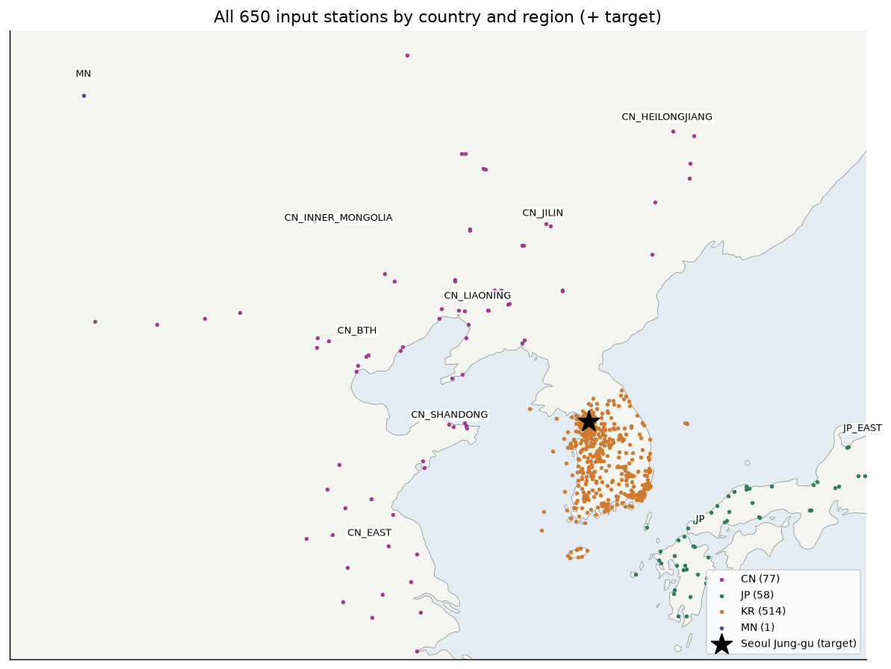
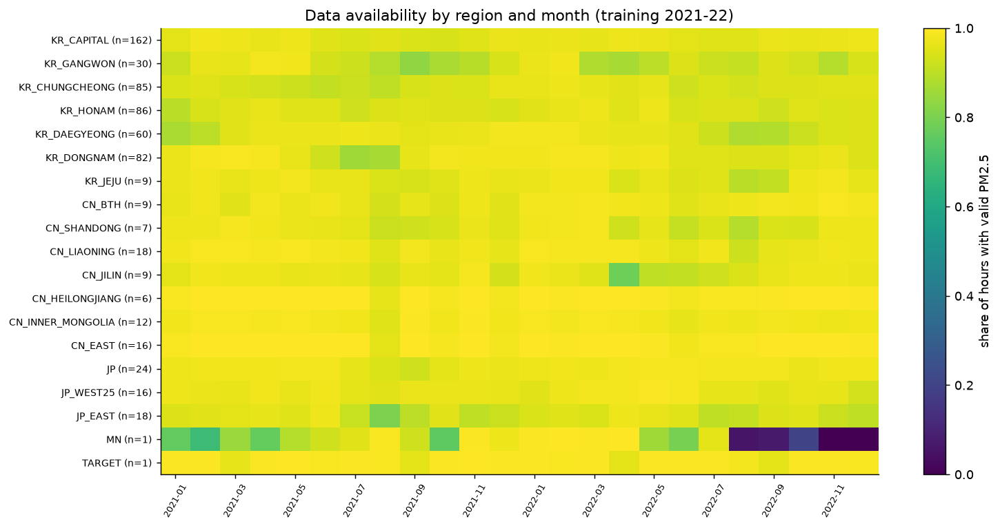
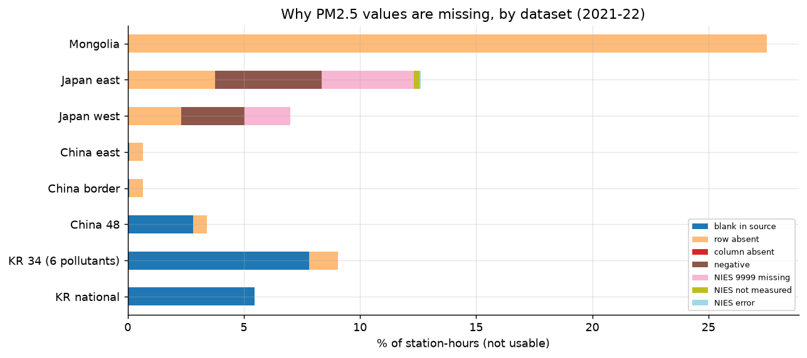
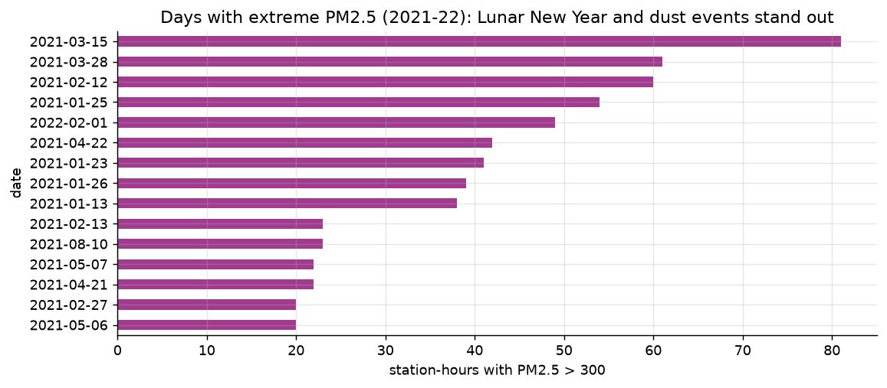
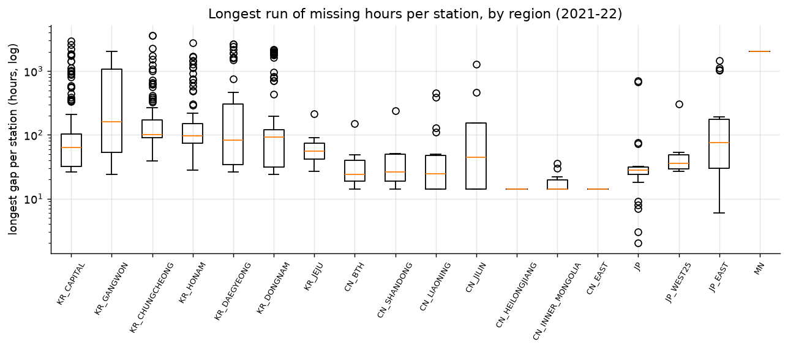

# 1. 자료 구성과 품질 점검

어떤 자료가 있고, 믿을 수 있는지 확인합니다. 학습 구간(2021–22)만 봅니다.

| 스크립트 | 내용 |
|---|---|
| `eda_e0_overview.py` | 출처별 행 수·측정소 수, 측정소 지도, 권역 × 월 가용률 |
| `eda_e1_quality.py` | 결측 이유(flag), 최장 공백, 이상치, 같은 값 반복, 일본 음수, ASOS 품질 |

## 자료 구성

| 자료 | 행 수 | 측정소 | 오염물질 |
|---|---|---|---|
| 국내 전국 PM2.5 | 1,940만 | 573 | PM2.5 |
| 국내 34곳 | 119만 | 34 | PM2.5, PM10, SO₂, NO₂, O₃, CO |
| 중국 48곳 | 168만 | 48 | 6종 |
| 중국 국경 도시 / 동부(대조) | 46만 / 105만 | 13 / 30 | PM2.5, PM10 |
| 일본 서부 / 동부(대조) | 799만 / 536만 | 228 / 153 | PM2.5 |
| 몽골 울란바토르 | 3.5만 | 1 | PM2.5, PM10 |
| ASOS 서울 108·백령도 102 | 7만 | 2 | 기상 6종 |
| HYSPLIT 역궤적 | 256만 점 | 100/500/1000 m 도착 | 72시간 경로 |

- 모델 입력 측정소는 650곳입니다(국내 514, 중국 77, 일본 58, 몽골 1).
- 학습 구간 가용률은 대부분 92–99%이고, 몽골만 72%입니다.

## 품질

| 자료 | 결측 % | 최댓값 | > 500 | 24시간 이상 같은 값 | PM2.5 > PM10 |
|---|---|---|---|---|---|
| 국내 전국 | 5.5 | 803 | 9 | 4,039시간 | – |
| 국내 34곳 | 9.0 | 307 | 0 | 0 | 382 |
| 중국 48곳 | 3.4 | **9985** | 67 | 152 | **17,560** |
| 중국 국경 | 0.7 | 1,853 | 117 | 0 | 1,125 |
| 일본 서부 | 7.0 | 330 | 0 | 298 | – |
| 일본 동부 | 12.6 | 212 | 0 | 295 | – |
| 몽골 | 27.5 | 848 | 117 | 0 | 0 |

- **오류값:** 중국 3578A의 9985(2021-03-15)는 PM2.5가 PM10보다 큰 오류값입니다.
- **극단값이 몰린 날:** 황사일(2021-03-15, 03-28)과 설날(2021-02-12, 2022-02-01)입니다.
- **일본 음수:** 서부 10.9만 시간, 동부 12.4만 시간이 음수라 결측으로 처리되어 있습니다. 깨끗한 날의 측정 잡음입니다.
- **긴 공백:** 몽골은 최장 2,052시간(약 3개월) 연속 결측이 있습니다. 국내에도 수개월 공백이 있는 측정소가 있습니다.
- **ASOS:** 기온·습도·기압·바람은 결측이 거의 없습니다. 강수는 88–89%가 공란인데, 비가 오지 않은 시간이 0이 아니라 공란으로 기록된 것으로 보입니다.
- **시사점:** 모델은 이상치를 자르지 않고 그대로 학습했습니다. 9985 같은 명백한 오류값은 다음 실험부터 빼야 합니다.

