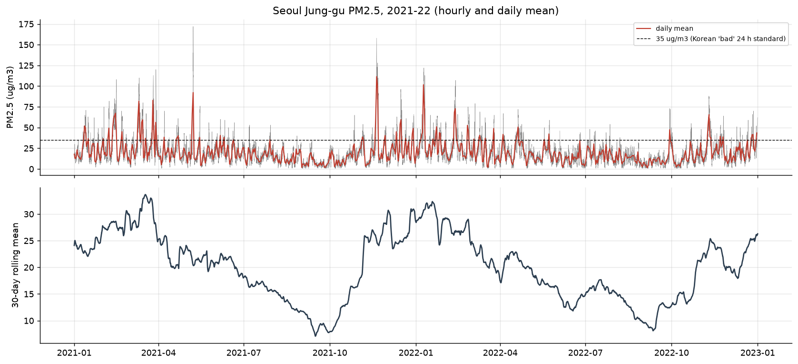
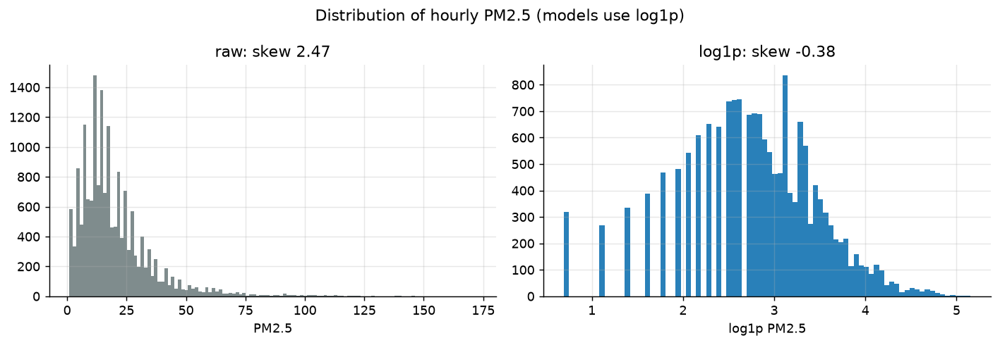
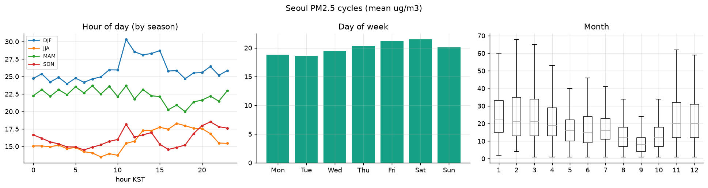
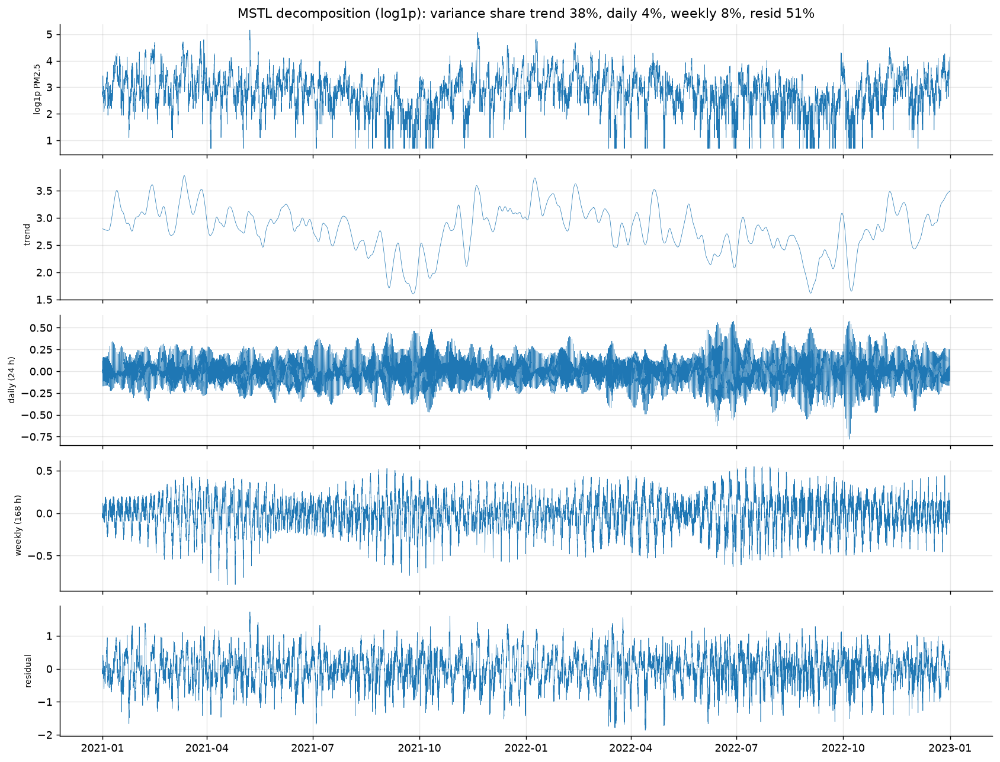
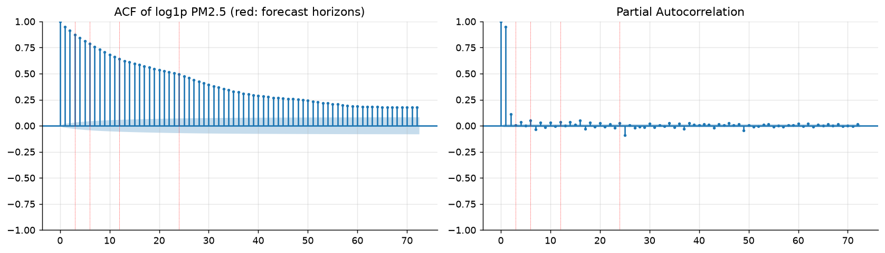
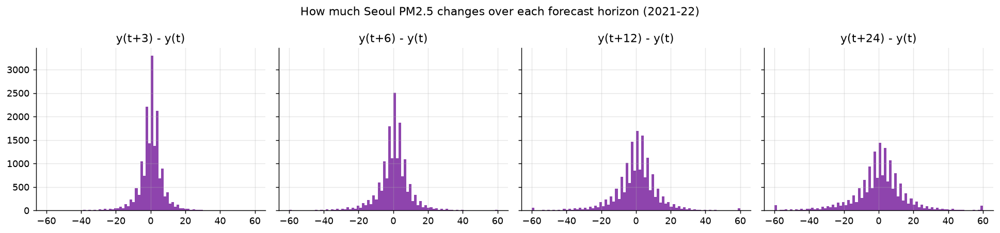
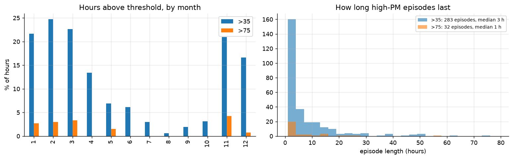
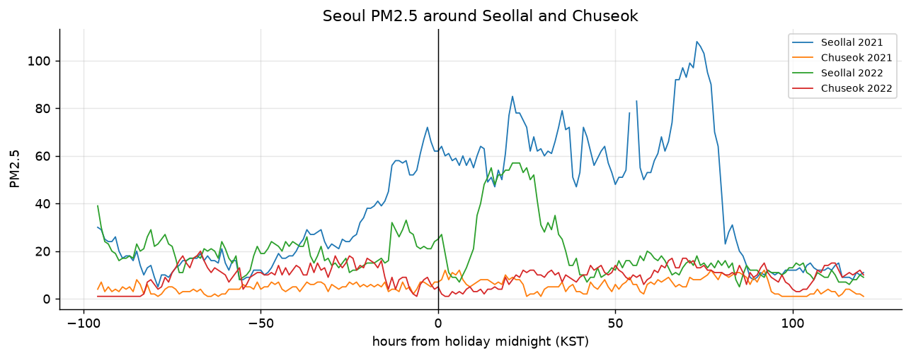

# 2. 서울 PM2.5 시계열 특성

예측 대상인 서울 중구 시간별 PM2.5가 어떤 시계열인지 봅니다(`eda_e2_target.py`, 2021–22).

- **분포:** 평균 20.0, 중앙값 16, 99% 분위 84, 최대 172 µg/m³입니다. 오른쪽으로 긴 꼬리가 있어서 모델은 log1p로 변환해 씁니다.
- **주기:**
  - 11–3월이 높고 8–9월이 가장 낮습니다.
  - 35 µg/m³ 초과 시간은 2월 25%, 8월 0.6%입니다.
  - 요일 차이는 작습니다(금·토가 약간 높음).
  - 겨울에는 오전 11시 전후에 높습니다.
- **분해(MSTL):** 분산 비중은 추세 38%, 하루 주기 4%, 주 주기 8%, 잔차 51%입니다. 주기만으로는 예측할 수 없습니다.
- **정상성:** ADF는 정상, KPSS는 비정상으로 결론이 갈립니다. 계절 추세가 있는 약한 비정상 시계열입니다.
- **지평별 변화:**
  - 학습 구간 Persistence RMSE는 7.3 / 10.2 / 13.5 / 16.9입니다.
  - 현재 값과의 상관은 0.90 / 0.80 / 0.65 / 0.45로 떨어집니다.
  - 24시간 뒤에는 현재 값만으로 부족해서 외부 정보가 필요합니다.
- **고농도:**
  - 35 초과는 283회 있었습니다. 지속 시간 중앙값은 3시간이고, 93%가 하루 안에 끝납니다.
  - 75 초과는 32회이고 11–3월에 몰려 있습니다.
- **명절:** 2021 설날 직후 사흘 평균이 25 → 65로 뛰었습니다. 중국 설 불꽃놀이와 같은 날이며, 같은 날 중국 측정소에도 극단값이 몰려 있습니다.

