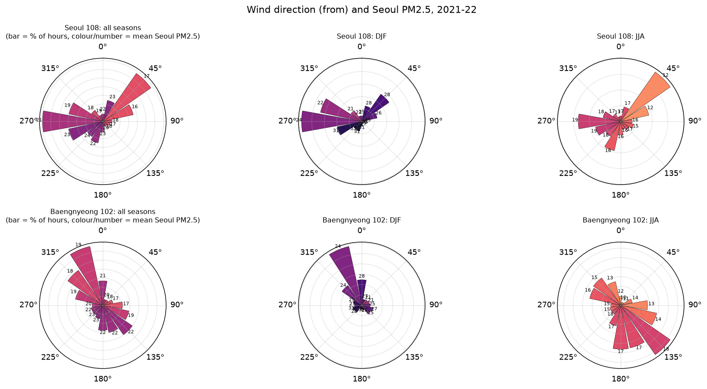
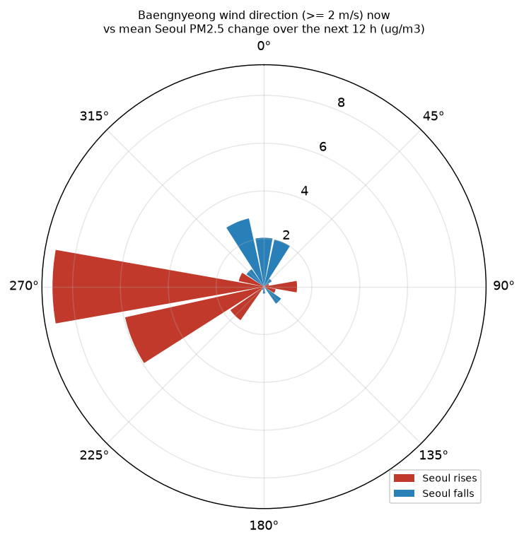
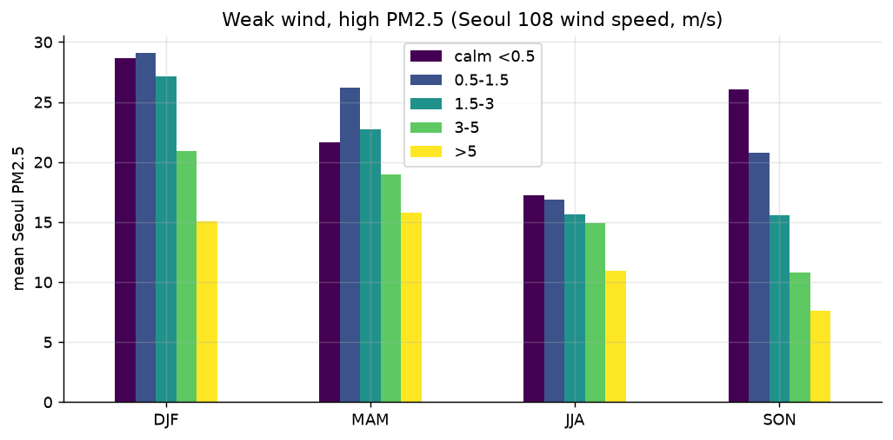
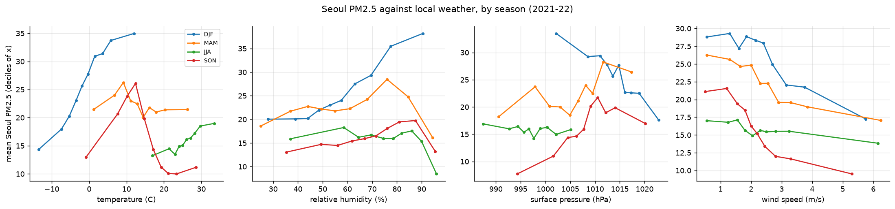
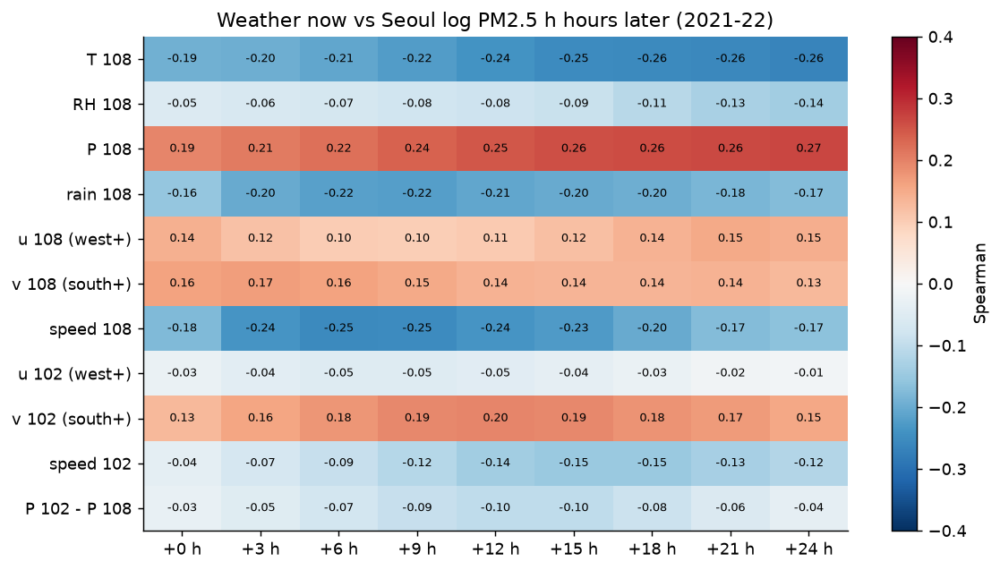
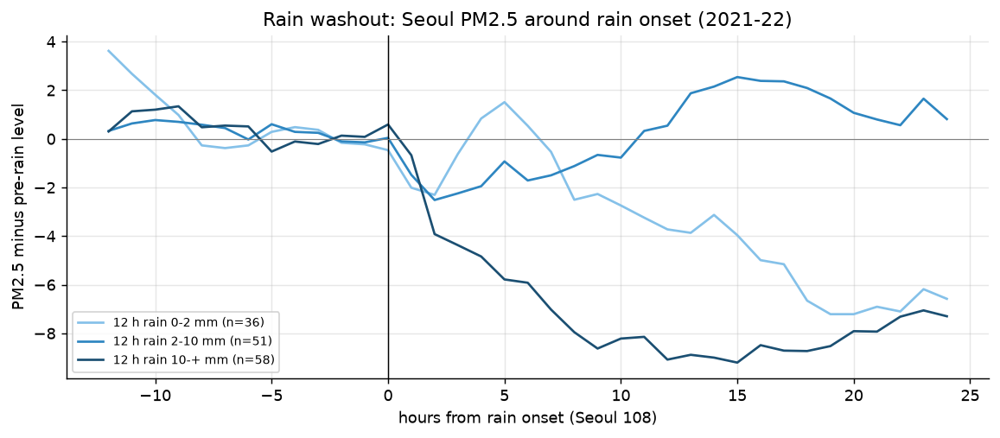

# 3. 기상 요인

서울 PM2.5가 지역 기상(ASOS 서울 108, 백령도 102)과 어떻게 연결되는지 봅니다(`eda_e3_meteorology.py`, 2021–22).

- **바람 세기:** 바람이 약할수록 PM이 높습니다.
  - 겨울: 무풍일 때 28.6, 초속 5 m 이상일 때 15.1 µg/m³
  - 가을: 26.0 → 7.6 µg/m³
  - 풍속과 PM의 상관은 모든 계절에서 음수입니다(−0.10 ~ −0.32).
- **바람 방향:** 서울 108 기준으로 겨울 서풍·서남서풍일 때 PM이 높고(평균 24–31), 여름 북동풍일 때 낮습니다(12).
- **백령도 바람(가장 뚜렷한 신호):** 지금 백령도에 부는 바람이 앞으로 12시간 서울의 변화를 알려 줍니다.
  - 서풍(270°)이면 서울이 평균 **+8.8 µg/m³**, 서남서풍이면 +5.9 오릅니다.
  - 북북서풍이면 −2.9, 북풍이면 −2.0 내려갑니다.
- **계절별 관계:**
  - 겨울에는 기온(+0.39)과 습도(+0.35)가 높을수록 PM이 높습니다. 따뜻하고 습한 정체 날입니다.
  - 가을에는 기압이 높을수록 높습니다(+0.30).
- **시차 상관:**
  - 서울 기압은 24시간 뒤 PM과 +0.27, 기온은 −0.26입니다.
  - 서울 풍속은 6시간 뒤 PM과 가장 강한 음의 상관(−0.25)을 보입니다.
  - 백령도 남풍 성분은 12시간 뒤 PM과 +0.20입니다.
- **강수 세정:**
  - 12시간 비가 10 mm 넘으면 12시간 뒤 PM이 평균 9.1 µg/m³ 내려갑니다(58회).
  - 2–10 mm 비는 뚜렷한 감소가 없었습니다(51회). 강수 공란을 0으로 본 한계가 있습니다.

