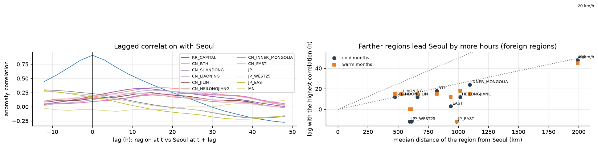
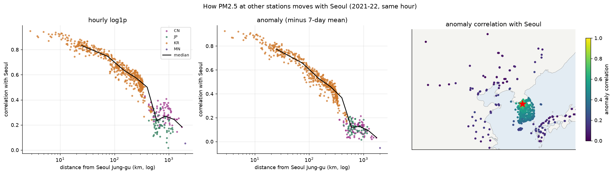
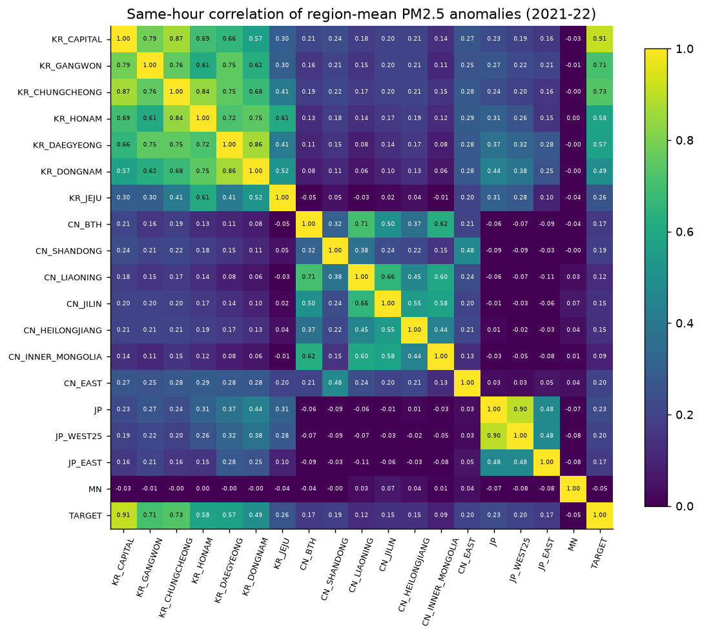
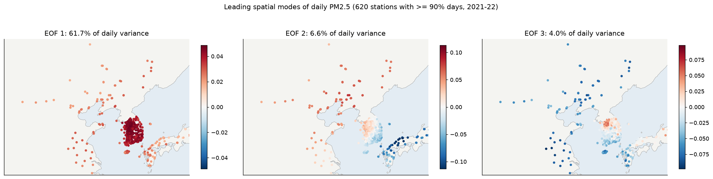

# 4. 공간 상관 구조

650개 측정소의 PM2.5가 서울과 어떻게 함께 움직이고, 어디가 서울보다 먼저 움직이는지 봅니다(`eda_e4_spatial.py`, 2021–22).

공통 계절 변동을 빼기 위해 **이상치(anomaly) = log1p − 7일 이동평균**으로 상관을 계산했습니다.

- **같은 시각의 상관:** 국가별 측정소와 서울의 상관 중앙값입니다.
  - 국내 0.52(원값 0.63)
  - 중국 0.10(0.31)
  - 일본 0.12(0.20)
  - 몽골 ≈ 0
  - 거리가 멀어질수록 빠르게 떨어집니다.
- **시차 상관(핵심):** 중국 권역은 **서울보다 12–24시간 먼저** 움직입니다.

| 권역 | 거리 | 최대 상관 시차 | 최대 상관 | 같은 시각 상관 | 환산 속도 |
|---|---|---|---|---|---|
| 산둥 | 475 km | +12 h | 0.33 | 0.19 | 40 km/h |
| 랴오닝 | 529 km | +15 h | 0.29 | 0.12 | 35 km/h |
| 지린 | 662 km | +15 h | 0.25 | 0.15 | 44 km/h |
| 징진지 | 821 km | +18 h | 0.34 | 0.17 | 46 km/h |
| 내몽골 | 1,095 km | +24 h | 0.24 | 0.09 | 46 km/h |
| 몽골 | 1,992 km | +48 h | 0.11 | −0.05 | 42 km/h |
| 일본 서부 | 597 km | **−12 h** | 0.30 | 0.23 | (서울이 먼저) |

- **해석:**
  - 먼 권역일수록 더 오래 앞서고, 환산 속도는 시속 35–46 km로 비슷합니다. 대기 수송과 맞는 패턴입니다.
  - 일본은 거꾸로 서울보다 12시간 늦게 움직입니다. 서울이 일본의 상류입니다.
  - 추운 달에 중국 권역의 최대 상관이 더 큽니다(0.28–0.44 vs 따뜻한 달 0.15–0.28).
- **모델과의 연결:** 같은 시각 상관만 보면 중국 정보는 거의 없어 보입니다. 하지만 **시차를 맞추면 2–3배 커집니다.** 입력의 시차 설계가 중요합니다.
- **EOF(일평균 공간 패턴):**
  - 1번 모드(62%)는 전 지역이 함께 오르내리는 공통 변동입니다.
  - 2번 모드(6.6%)는 중국·한반도 서부와 일본·한반도 남동부가 반대로 움직이는 동서 쌍극 패턴입니다.
  - 3번 모드(4%)는 수도권과 나머지의 차이입니다.

