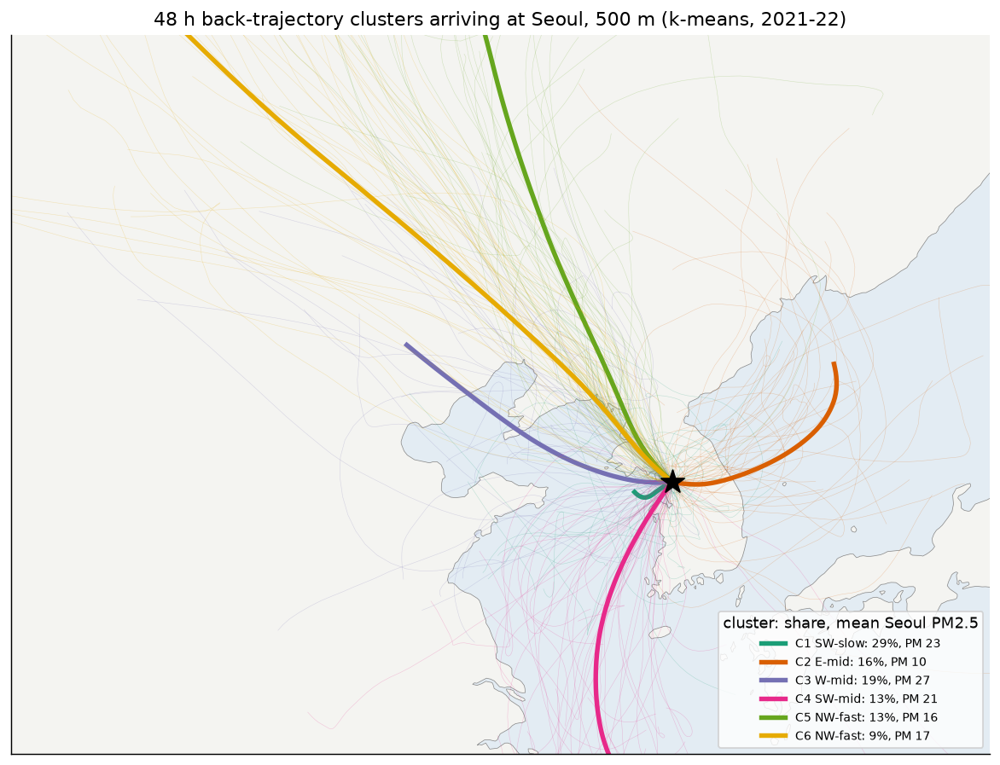
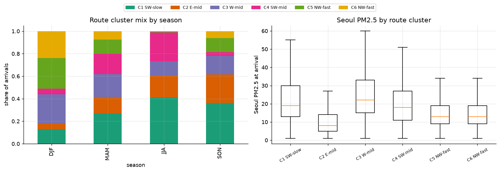
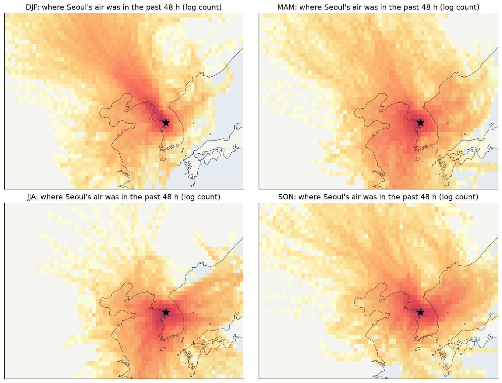
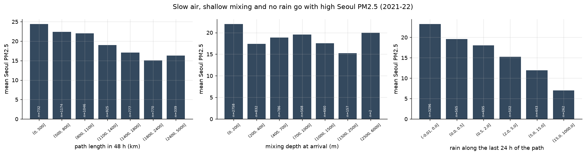
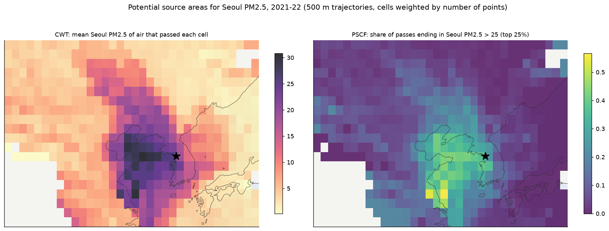
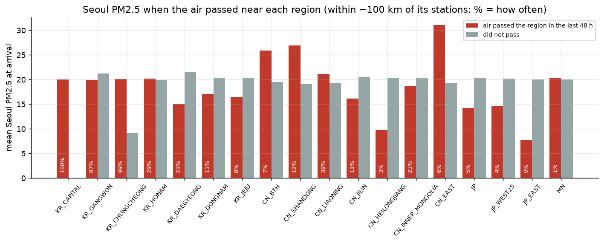
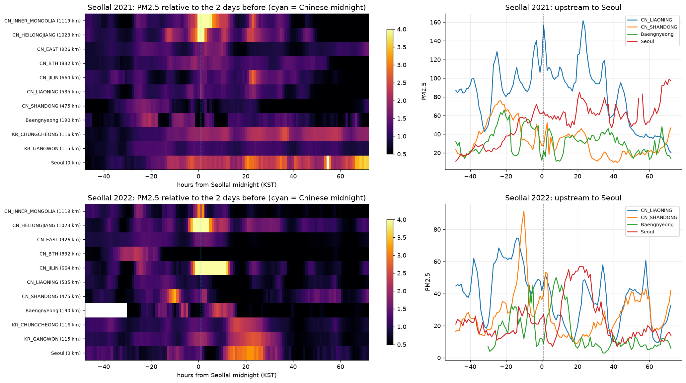
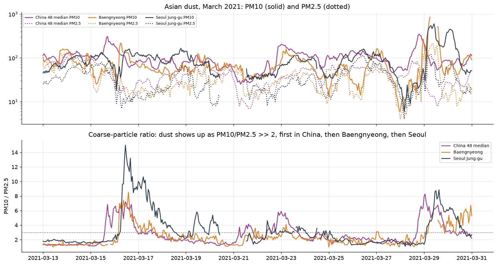
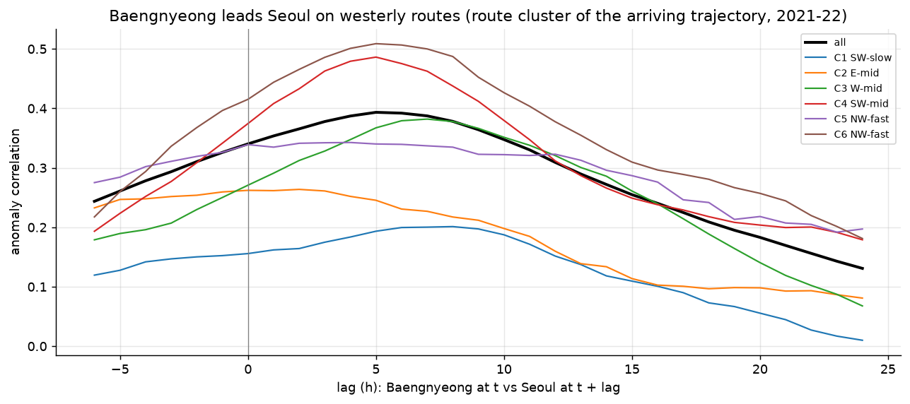
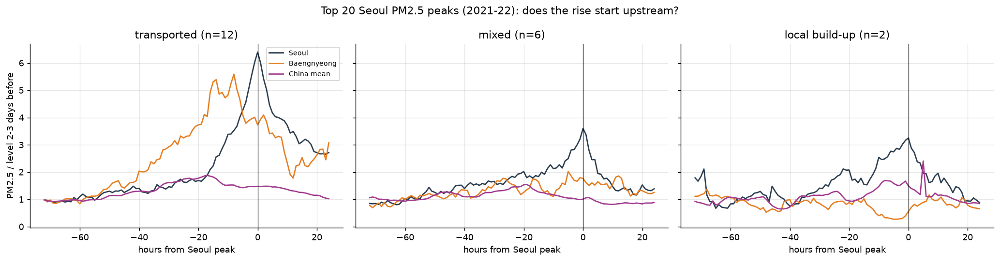

# 5. 이동경로와 수송 사건

공기가 어디서 왔는지(HYSPLIT 역궤적)와, 실제로 오염이 넘어오는 사건을 봅니다. 학습 구간(2021–22)만 씁니다.

| 스크립트 | 내용 |
|---|---|
| `eda_e5_trajectories.py` | 궤적 밀도, k-means 경로 군집, 경로 조건(속도·혼합고·강수), CWT/PSCF, 권역 통과 |
| `eda_e6_events.py` | 설날 불꽃놀이 펄스, 황사, 백령도 관문, 고농도 상위 20개 사례 |

`e5`를 먼저 실행해야 합니다. 경로 군집 표(`tables/e5_traj_clusters_2021_2023.csv`)를 다른 폴더의 분석에서도 씁니다.

## 경로 군집 (e5)

500 m에 도착하는 48시간 역궤적 5,840개를 k-means로 6개 경로로 나눴습니다.

| 경로 | 비율 | 서울 PM 평균 | 35 초과 비율 | 48시간 이동 거리 |
|---|---|---|---|---|
| C1 남서, 느림 (정체) | 29% | 23.4 | 17% | 598 km |
| C2 동쪽 | 16% | **10.3** | 1% | 1,043 km |
| C3 서쪽(서해 횡단) | 19% | **26.9** | **21%** | 1,181 km |
| C4 남서 | 13% | 20.5 | 11% | 1,252 km |
| C5 북서, 빠름 | 13% | 15.9 | 6% | 1,854 km |
| C6 북서, 매우 빠름 | 9% | 16.7 | 7% | 2,505 km |

- **계절:** 겨울은 북서(51%)·서쪽(26%) 경로가 많고, 여름은 남서(67%)·동쪽(20%) 경로가 많습니다. 경로와 계절이 겹쳐 있으므로 해석할 때 함께 봐야 합니다.
- **경로 조건:** 이동 거리(속도), 도착 혼합고, 경로상 24시간 강수는 모두 서울 PM과 음의 관계입니다(스피어만 −0.24, −0.16, −0.35).
- **CWT/PSCF:** 고농도 공기는 서해와 산둥·장쑤 연안, 한반도 서부를 지나온 경우가 많습니다.
- **권역 통과:**
  - 산둥(12%)·징진지(7%)·중국 동부(6%) 근처를 지나온 날은 서울 PM이 26–31로 평균(19–20)보다 높습니다. 다만 이런 날은 드뭅니다.
  - 랴오닝은 38%로 자주 지나오지만 차이가 작습니다(21 vs 19).

## 수송 사건 (e6)

- **설날 불꽃놀이(자연 실험):** 중국 자정(서울 01시) 직후 중국 북동부가 급등합니다.
  - 2021년: 내몽골 7.9배, 헤이룽장 5.1배
  - 2022년: 지린 11.3배, 헤이룽장 10.7배
  - **2022년에는 순서가 뚜렷합니다.** 백령도 +8시간(2.5배), 충청 +16시간, 서울 +21시간(3.2배) 순으로 퍼졌습니다.
  - 2021년에도 서울이 3.7배까지 올랐지만, 정점이 +71시간으로 늦어서 한 번의 펄스로 보기 어렵습니다.
- **황사:** 학습 구간에 서울 PM10 ≥ 100이면서 PM10/PM2.5 ≥ 3인 날이 10일 있었습니다(2021년 3·5월, 2022년 4·12월). 2021년 3월 사례에서 거친 입자 비율이 중국 → 백령도 → 서울 순으로 올라갑니다.
- **백령도 관문:** 백령도(국내 최서단 섬 측정소)는 서울보다 평균 5시간 앞서 움직입니다(상관 0.39).
  - 서쪽 경로 7시간, 남서 정체 8시간, 북서 4–5시간 앞섭니다.
  - 동쪽 경로에서는 2시간이고 약합니다.
- **고농도 상위 20개 사례:**
  - **수송형 12개:** 백령도가 2.5배 이상 먼저 오르고 바람이 있었던 경우입니다. 백령도가 서울보다 약 10시간 먼저 정점에 이릅니다.
  - **혼합형 6개, 국지 축적형 2개:** 바람이 약하고 상류 변화가 작았던 경우입니다.
  - 수송형은 주로 서쪽(5개)·북서 빠른(3개) 경로였습니다.
  - 분류는 간단한 규칙입니다(백령도 상승 배율과 서울 풍속).

