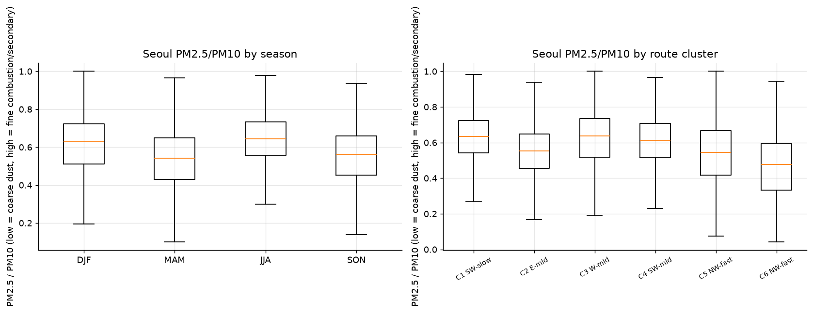
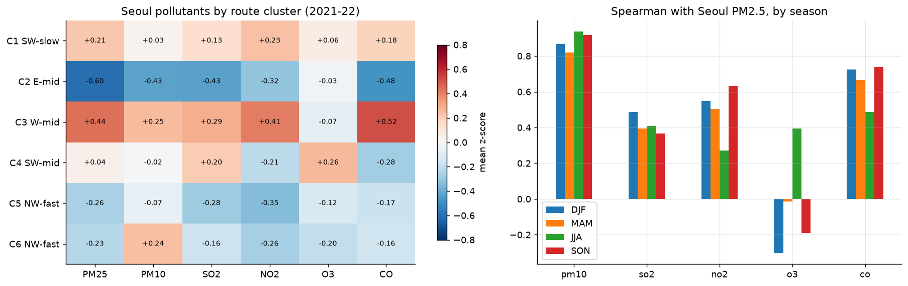
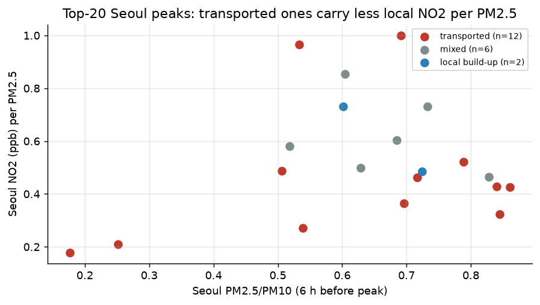
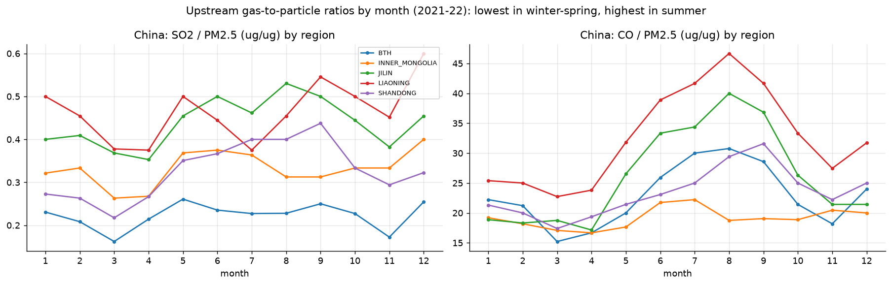

# 6. 화학 성분

PM2.5와 함께 오는 물질(PM10, SO₂, NO₂, O₃, CO)로 오염의 성격을 봅니다(`eda_e7_composition.py`, 2021–22).

국내 34곳은 ppm, 중국 48곳은 µg/m³(CO는 mg/m³)라 단위가 다릅니다. 그래서 비율은 같은 나라 안에서만 비교했습니다.

- **PM2.5/PM10:** 서울 중앙값은 봄 0.54로 가장 낮습니다(황사의 거친 입자). 여름 0.64, 겨울 0.63입니다.
- **경로별 성분:**
  - 서쪽 경로(C3)는 모든 오염물질이 높습니다(PM2.5 +0.44σ, CO +0.52σ, NO₂ +0.41σ).
  - 동쪽 경로(C2)는 모두 낮습니다(PM2.5 −0.60σ).
- **PM2.5와의 상관:**
  - CO(0.49–0.74), NO₂(0.27–0.63), SO₂(0.37–0.49)와 함께 움직입니다.
  - O₃는 여름에만 양의 상관(+0.39)을 보입니다. 여름철 2차 생성의 신호로 보입니다.
- **백령도와 서울:** 두 곳의 PM2.5 평균은 거의 같습니다(19.4 vs 20.0).
  - 그런데 PM2.5 1 µg/m³당 NO₂는 백령도 0.24 ppb, 서울 1.31 ppb로 **5배 차이**가 납니다.
  - 백령도의 PM2.5는 대부분 국지 배출이 아닌 바깥에서 온 것이라는 뜻입니다.
- **고농도 사례:**
  - 수송형 사례는 서울의 NO₂/PM2.5가 0.43으로, 국지 축적형(0.61)보다 낮습니다. 국지 배출 비중이 작다는 뜻입니다.
  - 다만 국지형은 2개뿐이라 참고만 해야 합니다.
- **중국 상류:** SO₂/PM2.5와 CO/PM2.5는 겨울·봄에 가장 낮고 여름에 가장 높습니다. 겨울에는 PM2.5 자체가 크게 늘어서 비율이 낮아집니다.

