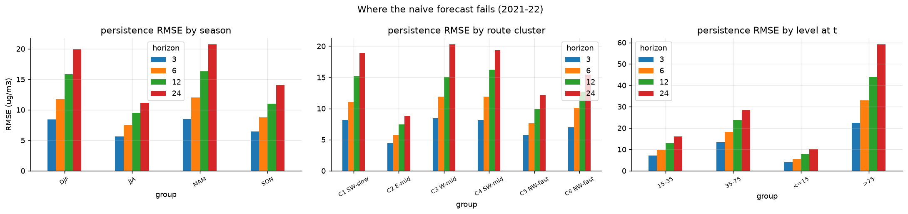
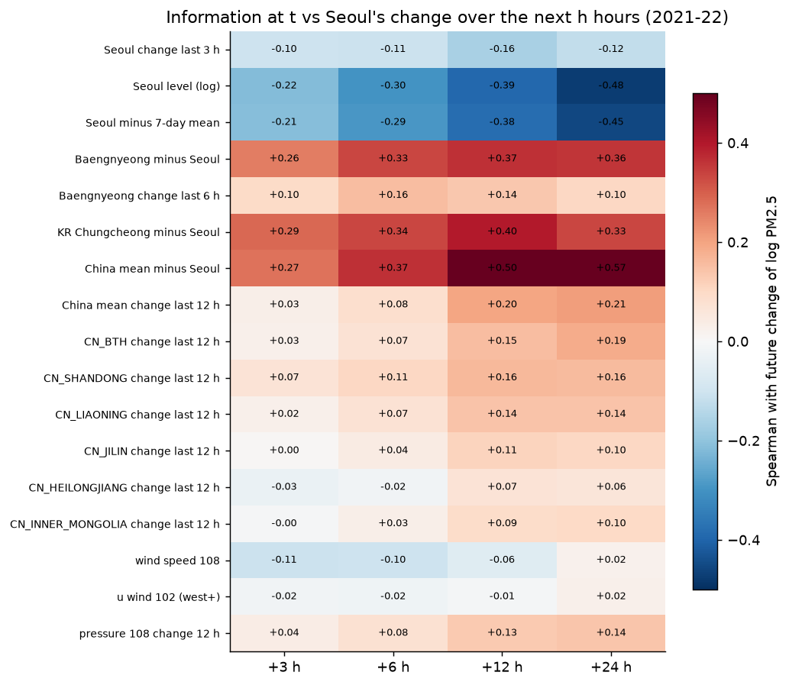
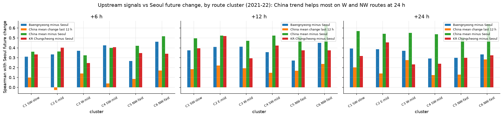
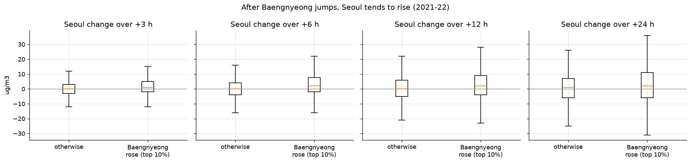
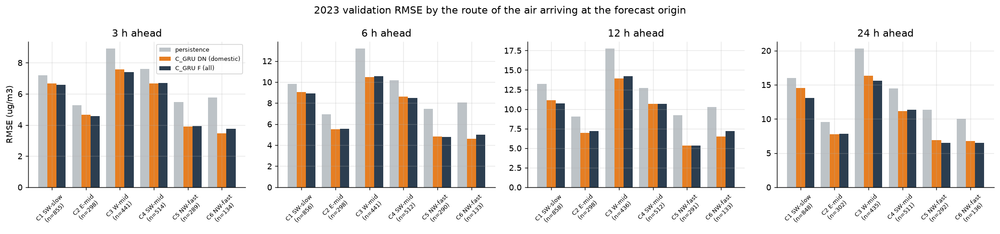
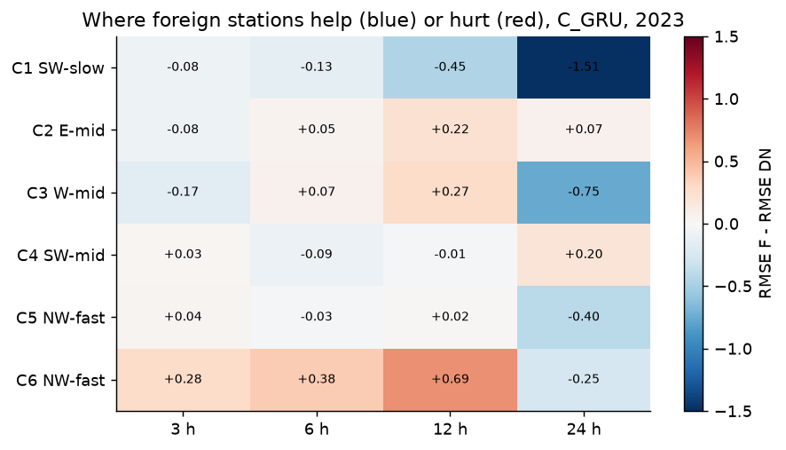
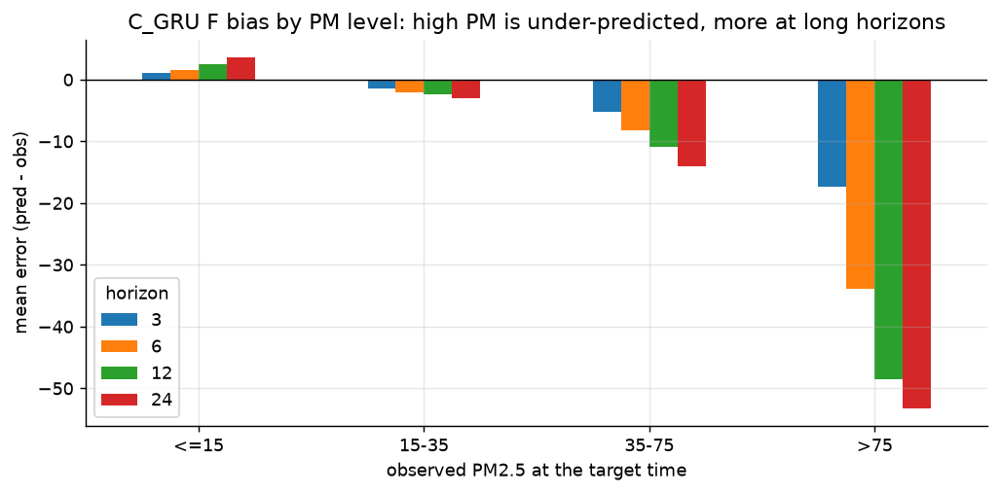
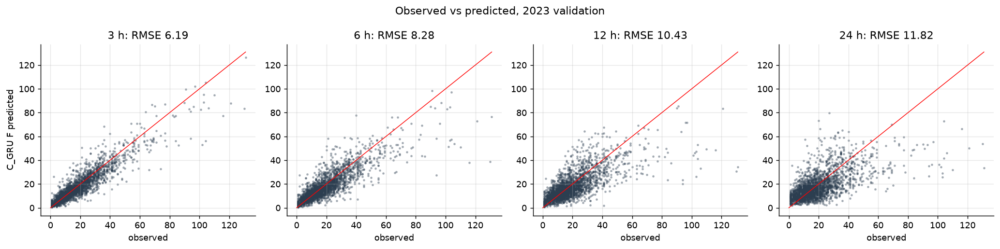

# 7. 예측 가능성과 모델 오차

무엇이 예측을 어렵게 하고, 어떤 정보가 앞으로의 변화를 알려 주는지 봅니다. 그다음 실제 모델(C_GRU)이 어디서 틀리는지 확인합니다.

| 스크립트 | 기간 | 내용 |
|---|---|---|
| `eda_e8_predictability.py` | 2021–22 | Persistence가 실패하는 조건, 변화를 알려 주는 정보, 상류 급등 이후의 서울 |
| `eda_e9_model_errors.py` | **2023 검증** | C_GRU F(전체)·DN(국내) 오차를 경로·계절·농도별로 분해 |

e9만 2023 검증 예측을 씁니다. 2024는 쓰지 않습니다.

## 예측 가능성 (e8)

- **Persistence가 크게 틀리는 때(24시간 RMSE):**
  - 계절: 겨울 19.9, 봄 20.7, 여름 11.1
  - 경로: 서쪽 20.3, 남서 정체 18.9, 동쪽 8.8
  - 현재 농도: 75 초과일 때 59.2
- **24시간 뒤 변화를 알려 주는 정보(스피어만):**

| 정보(시점 t) | +3 h | +12 h | +24 h |
|---|---|---|---|
| 서울 현재 농도 | −0.22 | −0.39 | −0.48 |
| **중국 평균 − 서울** | +0.27 | +0.51 | **+0.57** |
| 백령도 − 서울 | +0.26 | +0.37 | +0.36 |
| 충청 − 서울 | +0.29 | +0.40 | +0.33 |
| 중국 최근 12시간 변화 | +0.03 | +0.20 | +0.21 |
| 서울 풍속, 기압 변화 | \|r\| ≤ 0.11 | \|r\| ≤ 0.13 | \|r\| ≤ 0.14 |

- **해석:**
  - 높으면 내려가는 평균 회귀가 가장 강한 신호입니다.
  - 그 위에 **"상류가 서울보다 얼마나 높은가"(농도 차이)**가 더해집니다. 상류의 최근 변화보다 이 차이가 훨씬 정보가 많습니다.
  - "중국 − 서울"에는 서울 농도가 들어 있습니다. 그래도 서울 농도 하나(−0.48)보다 상관이 큽니다(+0.57).
- **경로별:** 중국의 최근 변화는 24시간에서 서쪽·북서 경로(0.28)에서 더 유용합니다(동쪽·남서 0.12–0.14).
- **백령도 급등 뒤:** 백령도가 6시간 동안 상위 10%로 오르면, 6시간 뒤 서울이 오르는 비율이 59%입니다(그 외 47%).

## 모델 오차 (e9, 2023 검증)

C_GRU의 F(전체 측정소)와 DN(국내만)을 비교했습니다. 둘 다 시드 3개 평균입니다. 예측 시점 t에 도착한 궤적의 경로 군집으로 나눴습니다.

**F − DN RMSE 차이 (음수 = 해외 정보가 도움)**

| 경로 | 3 h | 6 h | 12 h | 24 h |
|---|---|---|---|---|
| C1 남서, 느림 | −0.08 | −0.13 | −0.45 | **−1.51** |
| C2 동쪽 | −0.08 | +0.05 | +0.22 | +0.07 |
| C3 서쪽 | −0.18 | +0.07 | +0.27 | **−0.75** |
| C4 남서 | +0.03 | −0.09 | −0.02 | +0.20 |
| C5 북서, 빠름 | +0.04 | −0.03 | +0.02 | −0.40 |
| C6 북서, 매우 빠름 | +0.28 | +0.38 | +0.69 | −0.25 |

- **경로별 난이도:** 서쪽 경로(C3)가 가장 어렵습니다(24시간 RMSE 15.6). 북서 경로는 쉽습니다(6.5).
- **해외 정보의 효과:** 24시간에서 정체·서쪽 경로일 때 크게 줄어듭니다. 계절로는 겨울 24시간(−1.10)에서 가장 큽니다.
- **고농도 과소예측:** 75 µg/m³ 초과 시점은 24시간 예측에서 평균 53 µg/m³ 낮게 예측합니다. 반대로 15 이하인 깨끗한 날은 약간 과대예측합니다. 평균으로 끌려가는 경향입니다.

