# 8. 다지점 측정소 네트워크

1–7번은 주로 서울 중구와 백령도를 기준으로 봤습니다. 여기서는 **측정소 650곳 전체**(국내 514, 중국 77, 일본 58, 몽골 1)와 국내 다물질 측정소 34곳, 중국 48곳을 각각 하나의 지점으로 놓고 비교합니다. 학습 구간(2021–22)만 씁니다.

| 스크립트 | 내용 |
|---|---|
| `eda_e10_station_profiles.py` | 측정소별 농도 수준, 고농도 빈도, 계절비, 하루 주기, 네트워크 공통 변동 비중 |
| `eda_e11_network_dynamics.py` | 측정소별 서울과의 선후행, 권역 쌍 선후행, 큰 사례의 전파 지도, 데이터 기반 측정소 군집 |
| `eda_e12_regimes_and_composition.py` | 경로 체제별 전 측정소 합성 지도, 경로 민감도, 국내 34곳·중국 48곳 성분 비 |

## 측정소 특성 (e10)

| 권역(측정소 중앙값) | 평균 PM2.5 | 35 초과 비율 | 겨울/여름 | 하루 주기 폭 |
|---|---|---|---|---|
| 국내 수도권·충청 | 19.6–19.7 | 12–13% | 1.7–2.0 | 4.4–6.3 |
| 국내 강원·동남·제주 | 14.1–15.3 | 4–6% | 1.6–1.9 | 2.5–4.1 |
| 중국(6개 권역) | 23.6–34.4 | 18–32% | 1.9–3.4 | 4.8–15.7 |
| 중국 동부(대조) | 35.4 | 35% | 2.9 | 9.5 |
| 일본 | 8.0–9.8 | ≤ 1% | **0.8–1.1** | 2.0–2.5 |
| 몽골(1곳) | 70.4 | 47% | 3.0 | 88 |

- **농도 수준:** 가장 높은 측정소는 몽골 울란바토르와 중국 동부(지닝·짜오좡 44–46)입니다. 일본은 한국의 절반 수준입니다.
- **계절성:**
  - 중국 북동부는 겨울이 여름의 3배 안팎입니다(난방).
  - 한국은 약 2배입니다.
  - **일본은 겨울과 여름이 비슷하거나 여름이 더 높습니다.** 오염원 구성과 계절이 다르다는 뜻입니다.
- **하루 주기:**
  - 중국·몽골 측정소는 하루 안 변동이 큽니다(난방·역전층).
  - 한국과 중국의 정점은 오전 10시(KST) 전후, 일본은 저녁 18시 전후입니다.
- **네트워크 공통 변동(EOF 1이 설명하는 일 변동 비중):**
  - 수도권 0.82, 충청 0.80으로 대부분 공통 변동입니다.
  - 제주(0.35)와 섬·동해안 측정소는 국지 성분이 큽니다(울릉도 0.18–0.34, 제주 고산리 0.21).
  - 중국 0.16–0.31, 일본 0.08–0.20입니다.
  - 측정소의 79%가 한국이라 EOF 1이 한국 중심이라는 점은 감안해야 합니다.

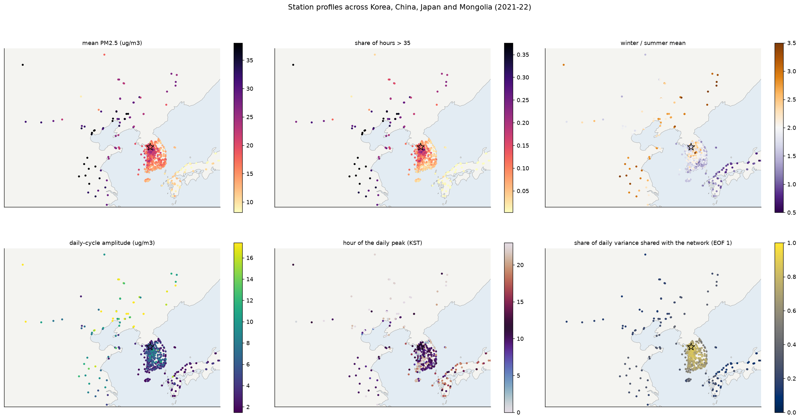

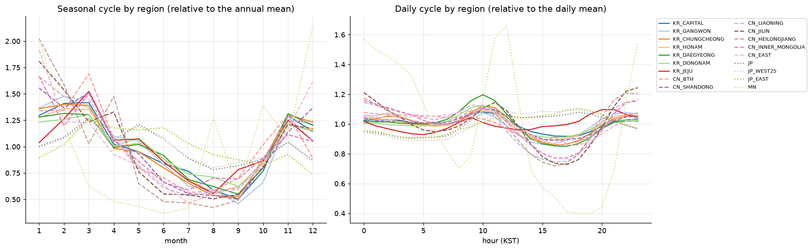

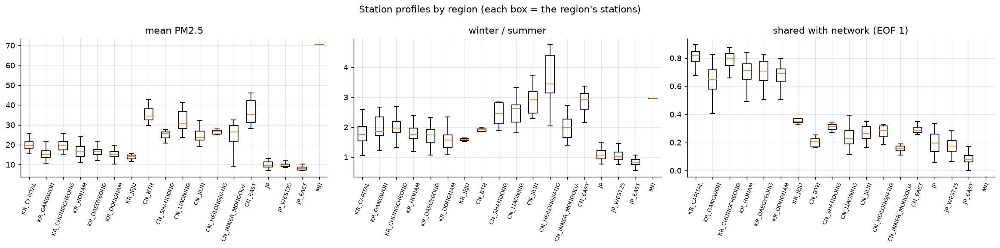

## 네트워크 동역학 (e11)

**측정소별 서울과의 선후행(이상치 교차상관이 최대가 되는 시차, 권역 중앙값)**

| 권역 | 서울보다 앞서는 시간 | 최대 상관 |
|---|---|---|
| 내몽골 | +19.5 h | 0.16 |
| 징진지 | +16 h | 0.28 |
| 랴오닝 / 지린 / 헤이룽장 | +15 / +15 / +14.5 h | 0.22 / 0.18 / 0.15 |
| 산둥 / 중국 동부 | +12 / +11.5 h | 0.28 / 0.15 |
| 국내 수도권 | 0 h | 0.76 |
| 국내 충청·호남·강원 | −1 ~ −2 h | 0.46–0.57 |
| 국내 대경·동남 | −3.5 ~ −4 h | 0.41–0.48 |
| 일본 서부 / 동부 | −12.5 ~ −15 / −21 h | 0.18–0.21 |

- **서→동으로 이어지는 시차:** 서쪽일수록 먼저, 동쪽일수록 늦게 움직입니다. 경도와 시차가 거의 일직선입니다.
- **서해 섬·해안 측정소:** 서울보다 2–3시간 앞섭니다(연평도·격렬비열도 +3시간, 충남·인천 서해안 측정소 +2시간). 백령도 하나가 아니라 **서해안 전체가 관문**입니다.
- **권역 쌍 선후행:**
  - 산둥 → 호남 14시간
  - 랴오닝 → 수도권 24시간
  - 징진지 → 산둥 11시간
  - 수도권 → 동남 2시간
  - 동남 → 일본 8시간, 수도권 → 일본 13시간
  - 징진지와 랴오닝, 내몽골과 징진지는 거의 동시에 움직입니다(0–1시간).
- **큰 사례의 전파:** 국내 전체가 높았던 4개 사례 모두에서 같은 순서가 보입니다.
  - 중국 북부가 서울보다 9–19시간 먼저 정점입니다.
  - 국내는 서울 전후 1–5시간입니다.
  - 일본은 12–33시간 늦게 정점입니다.
  - 예외: 2022-01-10 사례는 국내 대부분이 서울보다 늦게(+23시간) 정점에 이르렀습니다.
  - 남쪽의 중국 동부(대조)는 이런 사례에서 서울보다 늦게 정점인 경우가 많습니다. 북서풍 사례에서 상류가 아니라는 뜻입니다.
- **데이터 기반 측정소 군집(10개):** 대체로 행정 권역과 맞습니다. 다만 몇 가지가 다릅니다.
  - 수도권은 둘로 나뉩니다. 서울이 속한 군집(수도권 58곳)은 강원 22곳과 묶이고, 다른 군집(수도권 94곳)은 충청 11곳과 묶입니다.
  - 호남과 제주가 한 군집입니다.
  - 중국 북부 6개 권역은 하나로 묶이고, 산둥은 중국 동부와 묶입니다.
  - 국외 정보는 권역 단위보다 **"중국 북부"와 "산둥·중국 동부" 두 덩어리**로 다루는 편이 자료 구조에 맞습니다.

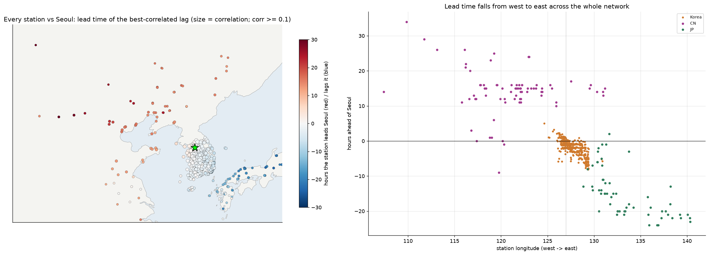

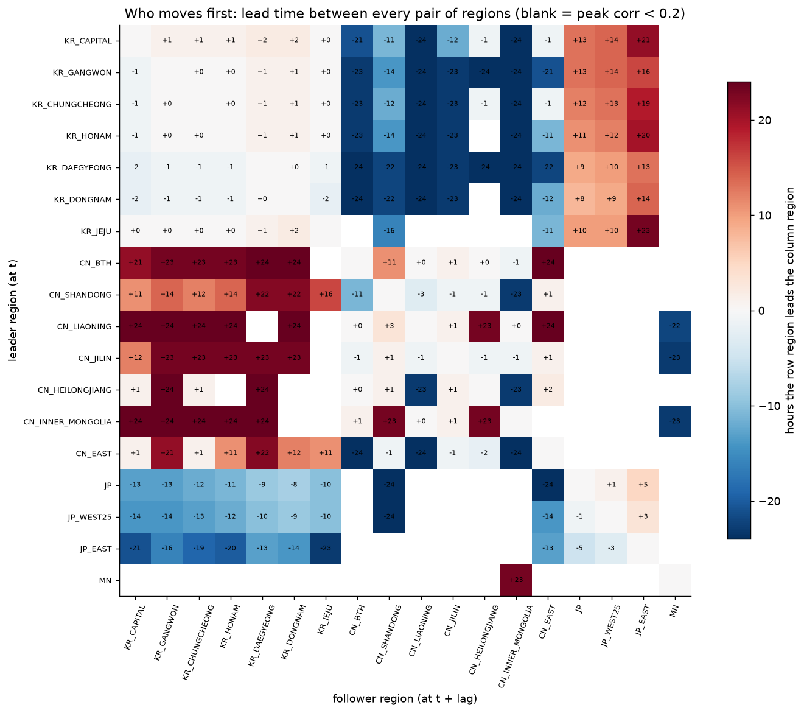

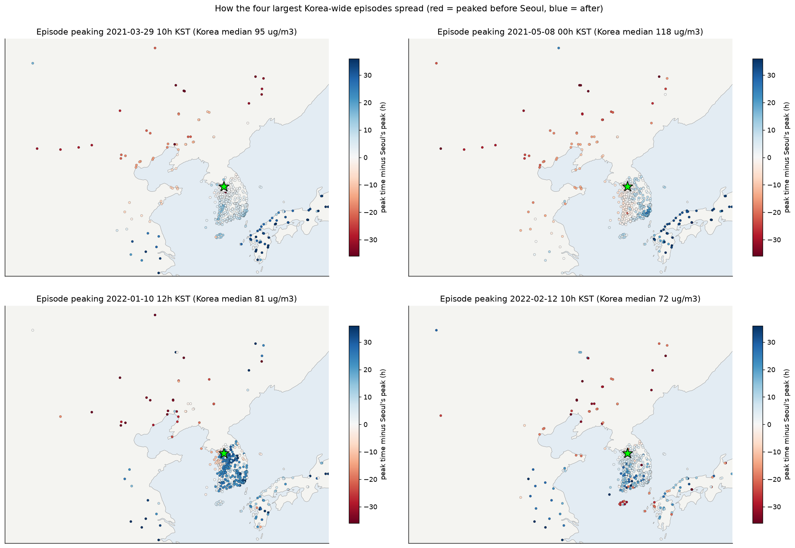

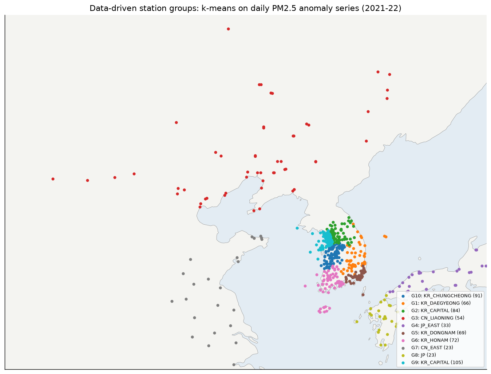

## 경로 체제와 성분 (e12)

**경로 체제별 전 측정소 합성(각 측정소 평균 대비 log PM2.5)**

| 체제 | 국내 | 중국 | 일본 |
|---|---|---|---|
| C2 동쪽 | **모두 낮음** (−0.24 ~ −0.58) | 낮음 | 낮음 |
| C3 서쪽(서해 횡단) | **모두 높음** (+0.25 ~ +0.36) | **함께 높음** (+0.08 ~ +0.31) | 거의 변화 없음 |
| C4 남서 | 서부 낮음, 동부·일본 높음 | 낮음 | **높음** (+0.15 ~ +0.35) |
| C5·C6 북서 빠름 | 서부 낮음 | 징진지·랴오닝 낮음 | 보통 |

- **C3(서쪽 경로):** 중국과 한국이 **함께** 높습니다. 수송뿐 아니라 동아시아 전체가 정체되는 기상 조건이 겹친 것으로 보입니다. 그랜저 검정에서 대조 지역이 유의했던 것(A 모델)과 같은 맥락입니다.
- **경로 민감도:**
  - 국내 측정소는 경로에 따라 PM이 평균의 54–82%만큼 달라집니다(수도권·강원이 가장 큼).
  - 중국은 34–63%, 일본은 39–59%입니다.
  - 국내·중국은 거의 모두 C3에서 가장 높습니다.
  - 일본은 C4(남서), 몽골은 북서 경로에서 가장 높습니다.
- **국내 34곳 성분:** 국가배경 섬 측정소(백령도·연평도·홍도·가거도·고산 등 11곳)는 다음과 같습니다.
  - PM2.5 1 µg/m³당 NO₂가 0.21–0.38 ppb로, 도시 측정소(0.41–1.31)보다 훨씬 적습니다.
  - 그런데도 PM2.5 평균은 13–21로 도시(16–24)와 비슷합니다.
  - 섬 측정소의 PM2.5는 대부분 바깥에서 온 배경 농도입니다.
- **중국 48곳 성분:** SO₂/PM2.5는 랴오닝(0.44–0.53)이 가장 높고 징진지(0.24–0.27)가 가장 낮습니다. 권역마다 오염원 구성이 다릅니다.

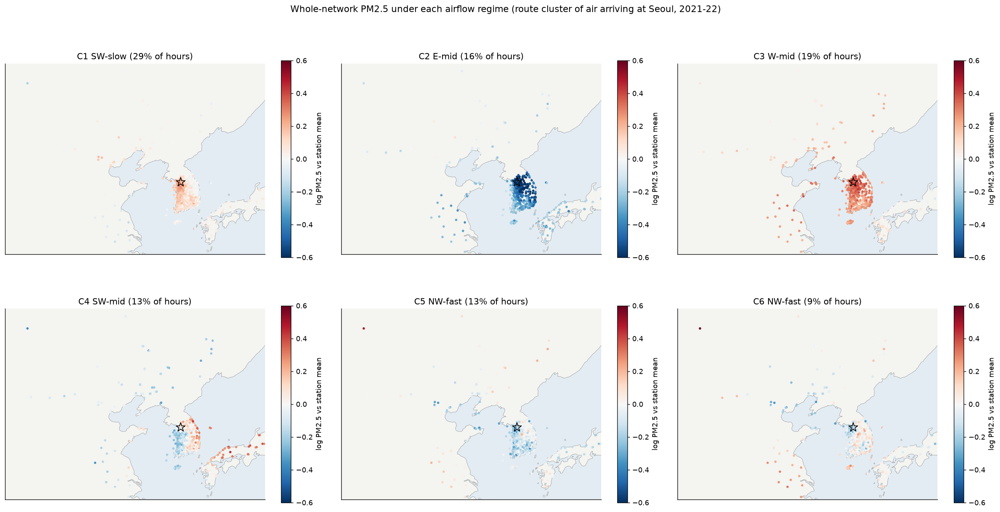

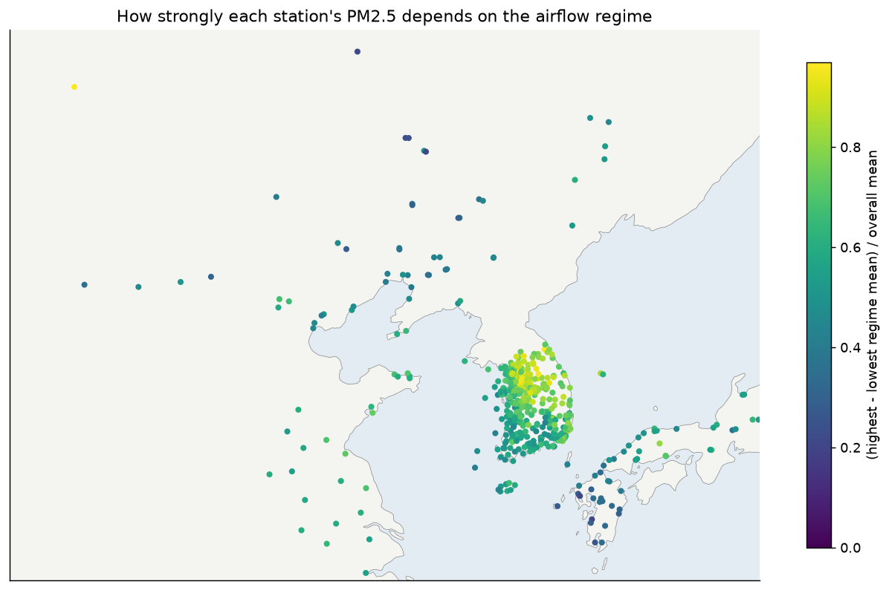

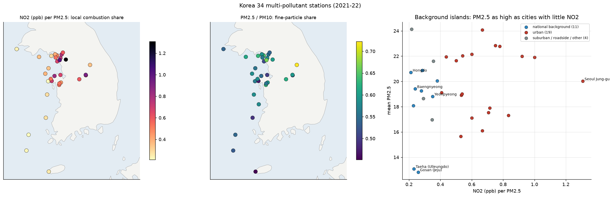

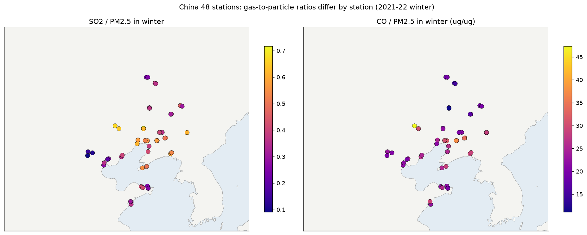
