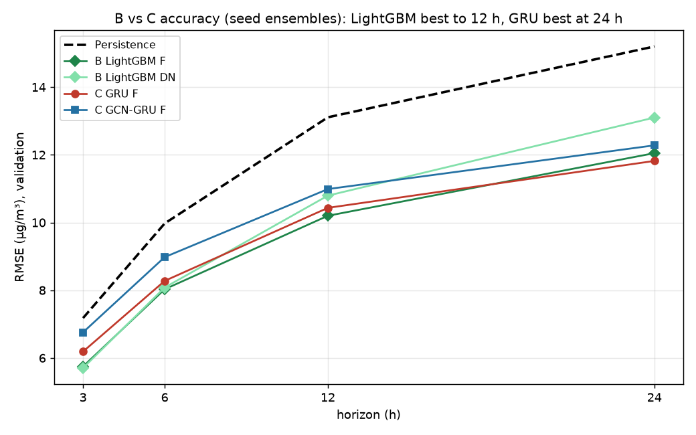
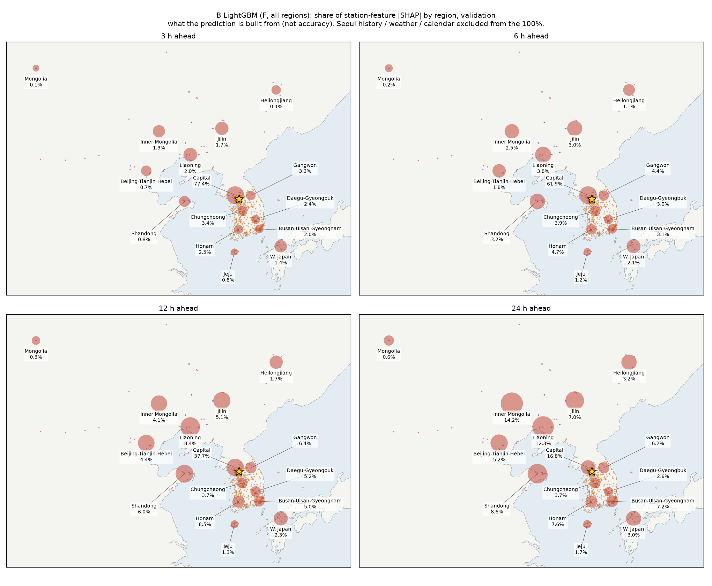
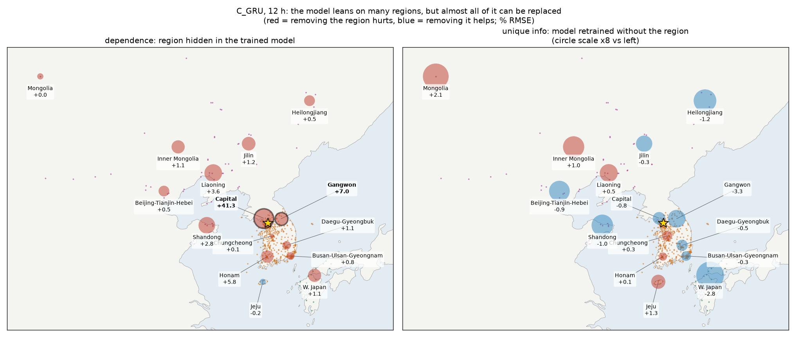
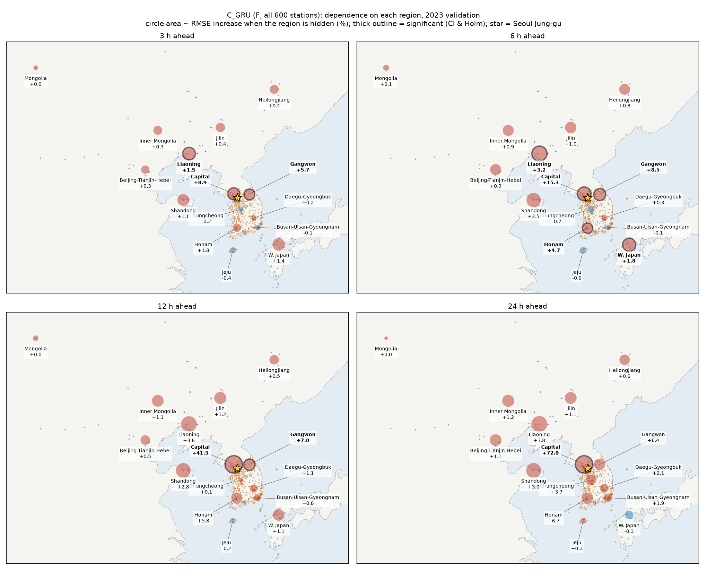
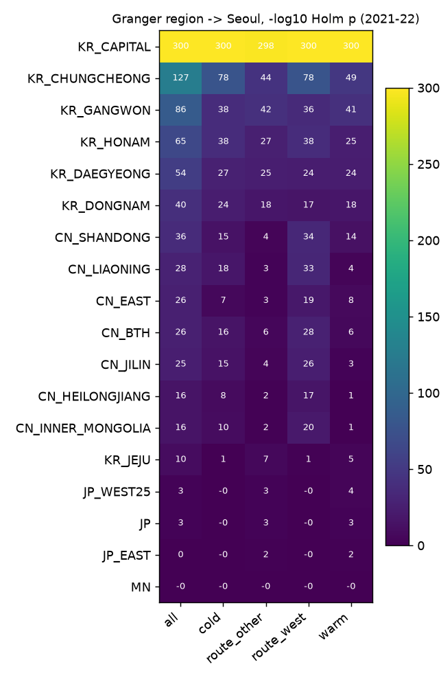

# 서울 중구 PM2.5 예측: 어느 지역 정보가, 언제 도움이 되나

**Team06 · 시계열데이터분석및실습**

서울 중구(KR:111121) PM2.5의 **3·6·12·24시간 뒤 값**을 예측합니다. 국내 514곳, 중국·일본·몽골 86곳의 관측과 HYSPLIT 역궤적을 이용해 다음 세 가지를 검증합니다.

1. 어느 지역 정보가 예측에 도움이 되는가
2. 언제 도움이 되는가
3. 어떤 모델 구조가 그 정보를 잘 쓰는가

| 모델 | 방법 | 역할 |
|---|---|---|
| **A** | SARIMAX(권역 하나씩) + 그랜저 검정 | 선형 기준선, "앞서 움직이는 권역" |
| **B** | LightGBM 29개 입력 조건 + TreeSHAP | 본론: 정확도와 예측 근거 분해 |
| **C** | GRU / 거리 그래프 GCN-GRU / 무작위 그래프 대조 | 신경망 재현, 그래프의 가치, 지역 가리기 |
| D | DCRNN (팀원 담당) | 방향 그래프 vs 대칭 그래프 |

> **현재 상태 (2026-11-09):** 2023 검증 결과입니다. 2024 시험 구간은 모든 설정을 동결한 뒤 `--final`로 한 번만 엽니다. C는 177회 중 168회를 완료했습니다(GCN DROP 4개 권역은 일부 시드만 있음). 궤적 고도 바람·혼합고 특징(H1c)과 다른 오염물질은 아직 입력에 넣지 않았으며, 다음 실험입니다.

---

## 핵심 결과

### 1. 정확도: LightGBM은 12시간까지, GRU는 24시간에서 가장 좋다



| RMSE (µg/m³, 2023) | 3 h | 6 h | 12 h | 24 h |
|---|---|---|---|---|
| Persistence | 7.18 | 9.97 | 13.11 | 15.20 |
| A SARIMAX (ALL) | 6.46 | 9.35 | 11.36 | 12.48 |
| **B LightGBM (F)** | 5.75 | **8.03** | **10.20** | 12.05 |
| B LightGBM (DN, 국내만) | **5.70** | 8.08 | 10.79 | 13.10 |
| **C GRU (F)** | 6.19 | 8.28 | 10.43 | **11.82** |
| C GCN-GRU (F) | 6.76 | 8.98 | 10.99 | 12.28 |
| C GCN-GRU, 무작위 그래프 | 6.92 | 9.35 | 11.67 | 13.02 |

거리 그래프 GCN은 그래프 없는 GRU보다 나빴습니다(3·6시간 유의). 다만 무작위 그래프보다는 나아서, 그래프 자체에는 지리 정보가 담겨 있습니다.

### 2. 멀리 볼수록 예측이 중국 정보로 만들어진다 (B, TreeSHAP)



측정소 특징의 SHAP 비중을 보면, 수도권이 3시간 77%에서 24시간 17%로 줄어듭니다. 같은 24시간에 중국 권역 비중은 내몽골 14%, 랴오닝 12%, 산둥 9%로 커집니다.

### 3. 그러나 그 정보는 대부분 대체 가능하다 (C, 지역 가리기 vs 재학습)



- **왼쪽(지역 가리기):** 학습된 모델에서 랴오닝·산둥을 가리면 오차가 늘어납니다. 랴오닝은 3·6시간에서 유의합니다.
- **오른쪽(재학습):** 그 권역을 빼고 다시 학습하면 차이가 사라집니다. 대체 불가능한 정보는 **수도권 관측**뿐입니다(B·C 모두 유의).

### 4. 효과는 지평·계절·경로에 따라 다르다



| 질문 | 결과 |
|---|---|
| 중국 권역 추가가 오차를 줄이나? | **A(선형):** 24시간 랴오닝·징진지·산둥·지린, 12시간 산둥이 유의합니다. **B·C(비선형):** 12–24시간에 같은 방향으로 줄지만 유의하지 않습니다 |
| 언제 중국 정보를 더 쓰나? | **추운 계절**에 큽니다. C 가리기 12시간: 산둥 4.7% vs 0.4%. 그랜저 부분 R²는 1.5–6배입니다 |
| 서쪽 경로일 때 더 쓰나? | 그랜저(선형)는 **서쪽 경로에서 3–6배**입니다. C 가리기에서는 지지되지 않았습니다 |
| 궤적이 거의 안 지나는 지역은? | 일본 동해 쪽·일본 서부 대조는 효과가 없습니다(설계대로). 중국 동부는 그랜저만 유의해서, 공통 기상 변동 신호가 섞여 있음을 보여 줍니다 |



> 가리기·DROP·SHAP·그랜저는 모두 **예측 정보**를 재는 도구입니다. 배출 기여나 인과를 뜻하지 않습니다.

모델별 상세 결과와 그림:
- [`results/A/RESULTS_A.md`](results/A/RESULTS_A.md)
- [`results/B/RESULTS_B.md`](results/B/RESULTS_B.md)
- [`results/C/RESULTS_C.md`](results/C/RESULTS_C.md)

팀 보고용 Word 문서: [`reports/`](reports/)

---

## 실험 설계

| 항목 | 내용 |
|---|---|
| 데이터 | `Dataset_11_07_regions_v5.zip`. 팀 11-07 규약에 통과율 낮은 대조 지역(중국 동부 16곳, 일본 동해 쪽 18곳)을 더했습니다. 저장소에는 넣지 않습니다 |
| 분할 | 학습 2021–22 · 설정 선택 2023 · 최종 평가 2024 |
| 입력 조건 | D67(국내 67곳) · DN(국내 전국) · F(국내+국외) · ADD_r 8개 · DROP_r 15개 · CTRL 3개 |
| 채점 | 팀 공통 `score.py`. 고정 평가 행, DM 검정(HAC), 7일 블록 bootstrap, Holm 보정 |
| 개선 판정 | 95% 구간 상한 < 0 **그리고** Holm p < 0.05 |
| 시드 | 11·22·33. µg/m³ 시드 평균 앙상블과 시드별 점수를 따로 보고합니다 |

전체 흐름은 [`docs/PIPELINE.md`](docs/PIPELINE.md), 가설과 계획은 [`docs/C_PLAN.md`](docs/C_PLAN.md)와 [`docs/PLAN_A_to_D.md`](docs/PLAN_A_to_D.md)에 있습니다.

## 폴더 구조

```
A_sarimax/   asarimax.py        SARIMAX 권역별 + 그랜저 (+ --score, --figures)
B_lgbm/      blgbm.py           LightGBM 29조건 + TreeSHAP
             banalysis.py       채점, SHAP 표·그림
             bplots.py          SHAP 지도, 효과 그림, B vs C
C_graph/     cdata.py           651개 측정소 × 시간 캐시, 조건, 거리 그래프
             train.py           GRU / GCN-GRU / 무작위 그래프
             experiments.py     177회 실험 대기열 (재시작 가능, GPU 여러 장)
             occlude.py         지역 가리기
             score_all.py       가설별 채점 묶음
             region_contribution.py, plot_map.py, plot_summary.py
docs/        PIPELINE.md, C_PLAN.md, PLAN_A_to_D.md, make_report.py
results/     A/ B/ C/   예측(팀 형식), 점수, 표, 그림, RESULTS_*.md
reports/     팀 보고용 Word
assets/      Natural Earth 육지 경계 (지도용)
```

## 실행

```bash
pip install -r requirements.txt lightgbm statsmodels
export TSA_DATA=/path/to/data_v5          # 압축 푼 데이터 폴더
python C_graph/cdata.py                   # 캐시 (1–2분)
python C_graph/experiments.py --gpus 1 --per-gpu 4 --max-heavy 2
python B_lgbm/blgbm.py --jobs 8 --threads 14
python A_sarimax/asarimax.py --jobs 48
python C_graph/occlude.py && python C_graph/score_all.py && python C_graph/region_contribution.py
python B_lgbm/banalysis.py && python A_sarimax/asarimax.py --score && python A_sarimax/asarimax.py --figures
python C_graph/plot_map.py && python C_graph/plot_summary.py && python B_lgbm/bplots.py
```

- 실행 시간(L40S 1장, 128코어 기준): C 약 7–8시간, B 약 3시간(C와 동시), A 약 1시간
- 2024 최종 채점은 같은 명령에 `--split test --final`을 붙여 **한 번만** 합니다.
- 모델 체크포인트(`model.pt`)는 용량 때문에 저장소에서 제외했습니다.
