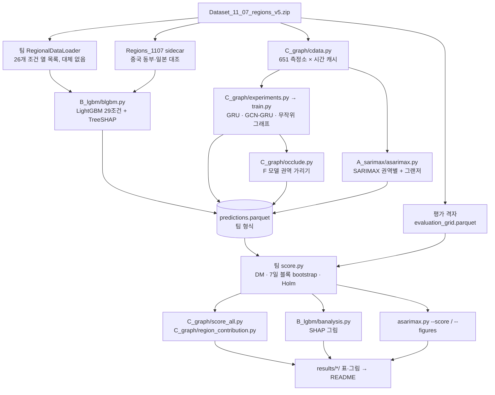

# 파이프라인

데이터 압축 해제부터 2024 최종 채점까지 A·B·C가 같은 입력 규약과 채점기를 씁니다.

## 순서

| 단계 | 명령 | 어디서 | 시간 (L40S 1장, 128코어) |
|---|---|---|---|
| 0 | `export TSA_DATA=<압축 푼 폴더>` | — | — |
| 1 | `python C_graph/cdata.py` | CPU | 1–2분 |
| 2 | `python C_graph/experiments.py --gpus 1 --per-gpu 4 --max-heavy 3` | GPU | 약 7–8시간 (177회) |
| 3 | `python B_lgbm/blgbm.py --jobs 8 --threads 14` | CPU, 2와 동시 | 약 3시간 |
| 4 | `python A_sarimax/asarimax.py --jobs 48` | CPU, 3 이후 | 약 1시간 |
| 5 | `python C_graph/occlude.py` | GPU | 수 분 |
| 6 | `python C_graph/score_all.py` · `python C_graph/region_contribution.py` | CPU | 수 분 |
| 7 | `python B_lgbm/banalysis.py` · `python A_sarimax/asarimax.py --score` · `--figures` | CPU | 수 분 |
| 8 | 같은 명령에 `--split test --final` | — | **모든 설정 동결 후 한 번만** |

## 규칙

- 학습 2021–22, 설정 선택 2023, 최종 평가 2024입니다.
- 모든 모델은 같은 평가 행(격자의 `eligible`)에서 팀 채점기로 비교합니다.
- 개선 판정은 RMSE 차이의 블록 bootstrap 95% 구간 상한 < 0 **그리고** Holm p < 0.05입니다.
- 시드별 점수와 µg/m³ 시드 평균 앙상블을 따로 보고합니다.
- 체크포인트(`model.pt`)는 저장소에 넣지 않습니다. 예측·학습 기록·점수는 넣습니다.
