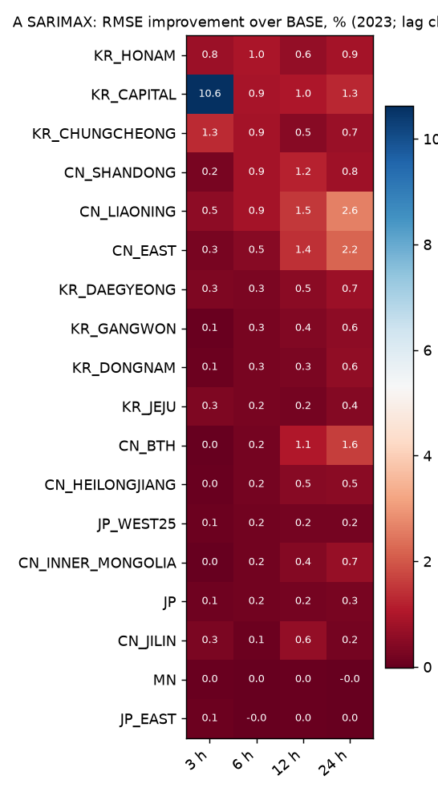
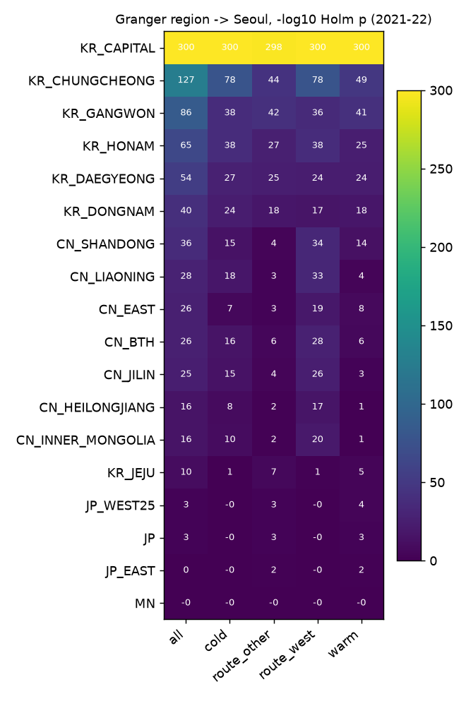

# 모델 A 결과 (SARIMAX 권역별 + 그랜저, 2023 검증)

작성 2026-11-09. 선형 기준 모델입니다.

**모델 구성**
- 오차 구조: ARMA(2,0,2). 후보 6개 중 2021–22 AIC로 골랐습니다.
- 계절성: 하루·연간 Fourier 항(각 K=2)을 외생변수로 넣었습니다.
- 권역 변수: 권역 평균 log1p PM2.5를 시차 L ∈ {h, h+3, h+6, h+12}로 넣고, L은 2023으로 골랐습니다.
- 모수는 2021–22로 한 번 적합하고 고정했습니다.

**판정 규칙:** 팀 채점기 기준, 블록 bootstrap 95% 구간 상한 < 0 **그리고** Holm p < 0.05.

## 정확도 (µg/m³ RMSE)

| 조건 | 3 h | 6 h | 12 h | 24 h |
|---|---|---|---|---|
| Persistence | 7.18 | 9.97 | 13.11 | 15.20 |
| BASE (Fourier + ARMA) | 7.10 | 9.61 | 11.88 | 13.37 |
| REG_KR_CAPITAL | **6.34** | 9.52 | 11.76 | 13.19 |
| REG_CN_LIAONING | 7.06 | 9.52 | 11.70 | **13.02** |
| ALL (전 권역, 시차 h) | 6.46 | **9.35** | **11.36** | 12.48 |

선형 모델이라 B(5.70 / 8.03 / 10.20 / 12.05)나 C보다 훨씬 약합니다. A는 비교 기준으로만 씁니다.

## 권역 하나씩 추가했을 때 (BASE 대비 RMSE 차이)

**유의한 개선(BASE 대비)**

| 지평 | 권역 | RMSE 차이 |
|---|---|---|
| 3 h | 수도권 | −0.75 |
| 6 h | 수도권 | −0.09 |
| 12 h | 산둥 | −0.14 |
| 24 h | 랴오닝 | −0.35 |
| 24 h | 징진지 | −0.22 |
| 24 h | 산둥 | −0.11 |
| 24 h | 지린 | −0.03 |

- ALL은 모든 지평에서 유의합니다.
- 선형 모델에서는 **중국 권역이 12·24시간에서 유의하게 도움**이 됩니다.
- 일본·몽골·일본 동해 쪽은 효과가 거의 0입니다.
- **주의:** 시차 L을 2023으로 골랐으므로 2023 점수는 낙관적입니다. 확정은 2024 최종 평가로 합니다.
- B·C에서는 같은 정보가 비유의였습니다. 비선형 모델은 국내 측정소만으로 이 정보를 이미 상당 부분 얻는다는 해석과 맞습니다.

**고른 시차:** 짧은 지평에서 중국 권역은 L = 9–15시간이 선택되었습니다. 즉 3시간 예측에 9–15시간 전 중국 값을 씁니다(`a_lag_table.csv`).

## 그랜저 검정 (2021–22, 권역 평균 → 서울 중구)

| 권역 | 전체 | 추운 계절 | 따뜻한 계절 | 서쪽 경로 | 그 외 경로 |
|---|---|---|---|---|---|
| 산둥 | 0.99 | 0.97 | 0.65 | **1.55** | 0.32 |
| 랴오닝 | 0.77 | 1.19 | 0.23 | **1.49** | 0.25 |
| 징진지 | 0.72 | 1.08 | 0.33 | **1.28** | 0.41 |
| 지린 | 0.69 | 1.01 | 0.17 | **1.17** | 0.34 |
| 중국 동부 (대조) | 0.72 | 0.49 | 0.40 | 0.88 | 0.26 |
| 일본 서부 | 0.11 | 0.05 | 0.20 | 0.04 | 0.29 |
| 일본 동해 쪽 (대조) | 0.04 | 0.00 | 0.15 | 0.01 | 0.23 |
| 몽골 | 0.00 | 0.04 | 0.03 | 0.01 | 0.01 |
| *수도권* | *22.5* | *26.7* | *20.1* | *26.0* | *18.2* |

값은 부분 R²(%)입니다. 권역의 과거값이 서울 중구 자체 과거값에 더해 설명하는 비율입니다.

- 중국 권역은 모두 Holm 보정 후 유의합니다.
- 중국 권역의 설명력은 **서쪽 경로일 때 4–6배, 추운 계절에 2–6배** 커집니다. 수송 가설(H2a)과 맞는 방향입니다.
- 일본은 반대로 "그 외 경로"에서 더 큽니다.
- **대조 지역 결과**
  - 일본 동해 쪽: 유의하지 않습니다. 예상대로입니다.
  - 중국 동부: 궤적이 4.9%만 지나는 대조 지역인데도 유의합니다(0.72%).
  - 즉 그랜저 유의성 일부는 **수송이 아니라 넓은 범위의 공통 기상·계절 변동**일 수 있습니다.
  - 그래서 그랜저는 단독 증거로 쓰지 않고, 경로·계절에 따른 **차이**로 읽어야 합니다.
- AIC로 고른 시차는 중국 1시간, 국내 2–3시간입니다. 시간 자료에서는 "몇 시간 앞서는지"보다 "추가 설명력이 있는지"로 해석하는 것이 맞습니다.

## 파일

| 경로 | 내용 |
|---|---|
| `scores/validation/` | 팀 채점기 출력 |
| `lag_choice.csv`, `a_lag_table.csv` | 권역 × 지평별 시차 선택과 시차별 RMSE |
| `coefficients_ALL.csv` | ALL 모형의 계수와 95% CI |
| `granger.csv` | 권역 × 부분집합의 F, p, Holm p, 부분 R² |
| `fits.csv` | 적합 167개의 AIC |
