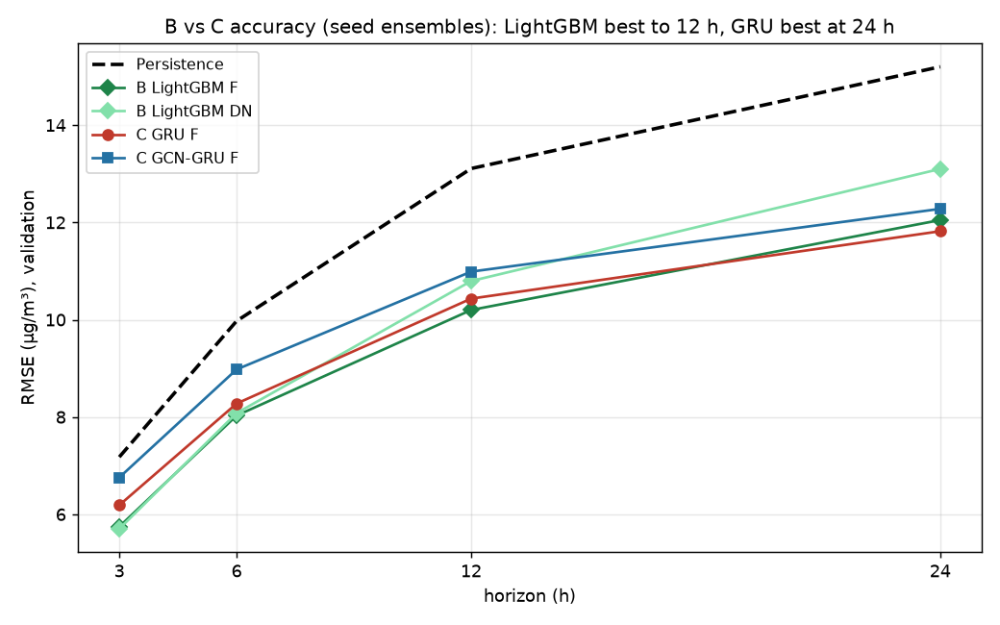
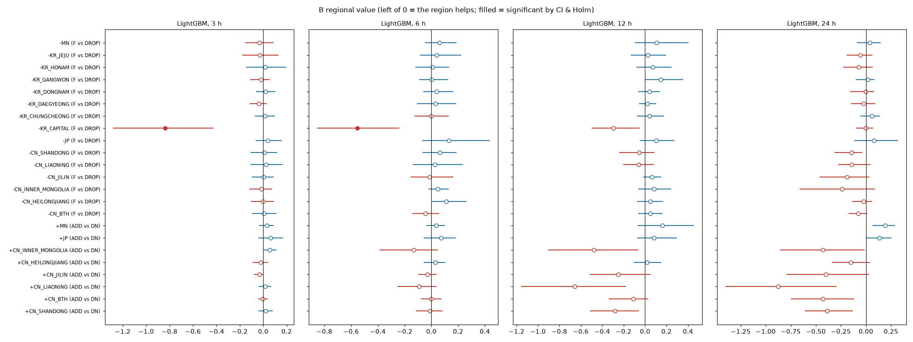
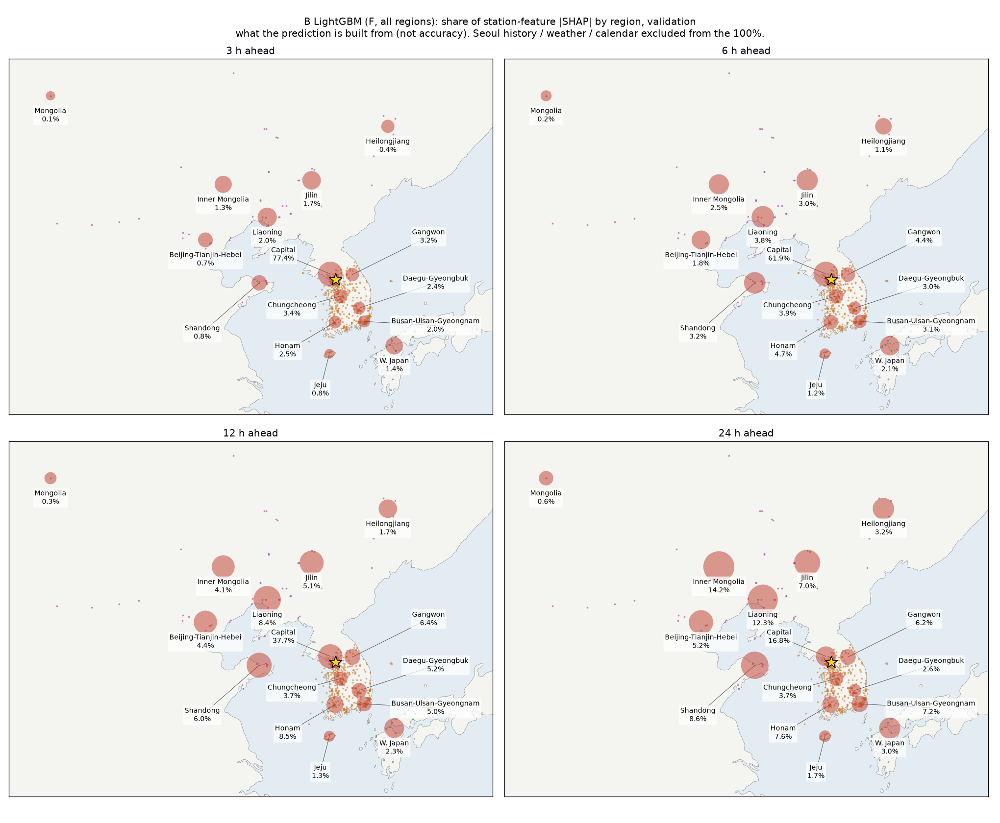
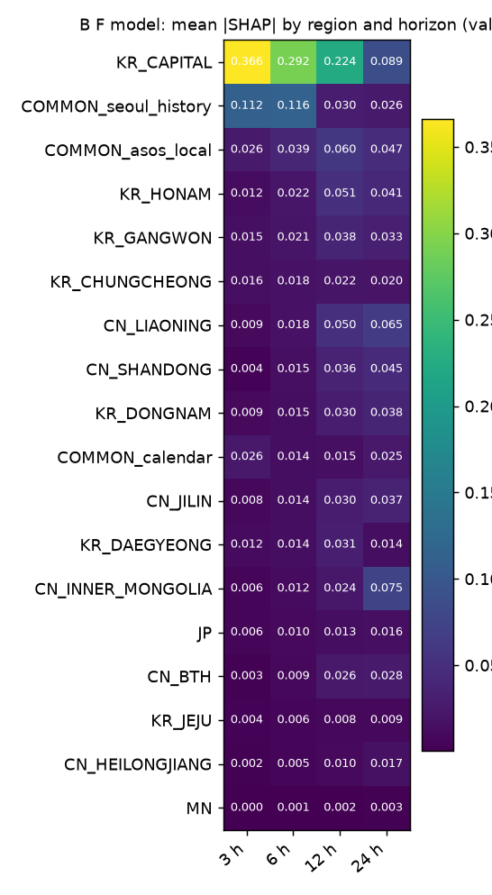
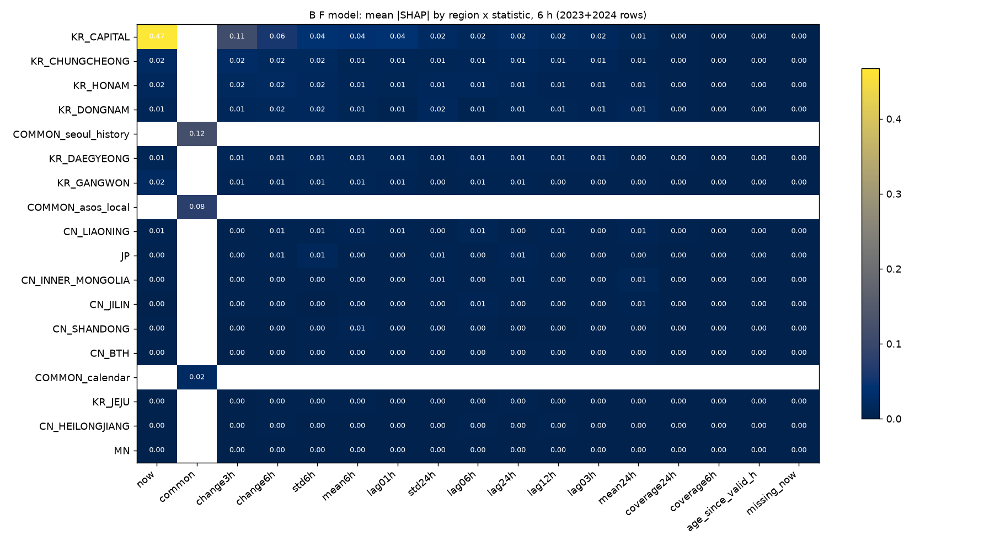
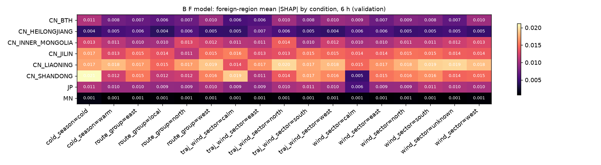
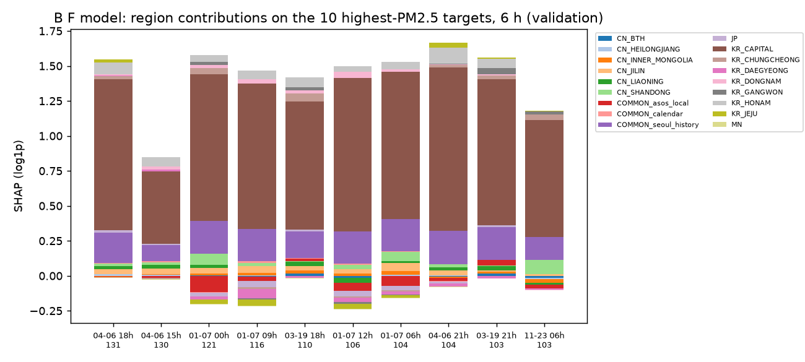

# 모델 B 결과 (LightGBM + TreeSHAP, 2023 검증)

작성 2026-11-09. 팀 채점기 기준이며, 29개 조건 모두 시드 3개(11·22·33) 앙상블입니다.

**판정 규칙:** 블록 bootstrap 95% 구간 상한 < 0 **그리고** Holm p < 0.05.

## 정확도 (µg/m³ RMSE)

| 조건 | 3 h | 6 h | 12 h | 24 h |
|---|---|---|---|---|
| Persistence | 7.18 | 9.97 | 13.11 | 15.20 |
| D67 (국내 67곳) | 5.93 | 8.28 | 10.57 | 12.65 |
| DN (국내 전국) | **5.70** | 8.08 | 10.79 | 13.10 |
| F (국내 + 국외 전체) | 5.75 | **8.03** | **10.20** | **12.05** |
| *참고: C GRU F* | 6.19 | 8.28 | 10.43 | 11.82 |

- LightGBM이 3·6·12시간에서 가장 정확합니다. 24시간은 C의 GRU가 더 낫습니다.
- F는 Persistence보다 오차가 지평별로 **20%, 19%, 22%, 21%** 작습니다.

## 권역의 추가 가치 (ADD / DROP)

- **유의한 것:** 92개 비교 중 2개입니다. 둘 다 `F vs DROP_KR_CAPITAL`(3·6시간, −0.84·−0.55)로, 수도권 관측은 다른 측정소로 대체되지 않습니다.
- **중국 권역 추가:** 12·24시간에서 **일관되게 오차를 줄이는 방향**입니다.
  - 랴오닝 −0.66 / −0.88, 내몽골 −0.48 / −0.43, 산둥 −0.28 / −0.39, 징진지 −0.11 / −0.43
  - 다중검정 보정 후에는 유의하지 않습니다.
- **일본·몽골 추가:** 모든 지평에서 오차가 오히려 조금 늘어납니다(+0.03 – +0.19).
- **F vs DN:** 24시간 −1.05로 가장 큰 차이지만 유의하지 않습니다.
- **대조 지역 3개(중국 동부, 일본 동해 쪽, 일본 서부 25곳):** 유의한 개선이 없습니다. 궤적이 거의 지나지 않는 곳이라 예상대로입니다.

## TreeSHAP: 예측이 어느 지역 정보로 만들어지나

F 모델에서 측정소 특징의 |SHAP|이 권역별로 차지하는 비중입니다. 서울 자체 이력, 기상, 달력은 비중 계산에서 뺐습니다.

- **3시간:** 수도권이 77%로, 예측이 거의 수도권 관측으로 만들어집니다.
- **24시간:** 수도권은 17%로 줄고, 중국 권역 비중이 커집니다(내몽골 14%, 랴오닝 12%, 산둥 9%, 지린 7%). 지평이 길수록 멀리 있는 상류 정보를 씁니다.
- **고농도 사례(6시간 상위 10건):** 대부분 수도권 현재값이 예측을 끌어올립니다. 중국 권역은 작지만 양(+)으로 기여합니다.
- **조건별(6시간):** 국외 권역 |SHAP|은 계절·경로에 따른 차이가 작습니다. 산둥만 추운 계절에 뚜렷하게 큽니다(0.021 vs 0.012).

| 그림 | |
|---|---|
| 권역 × 지평 |  |
| 권역 × 통계량 (6 h) |  |
| 국외 권역 × 조건 (6 h) |  |
| 고농도 사례 (6 h) |  |

**해석 주의:**
- SHAP은 **예측값을 만드는 데 쓰인 정도**이지 정확도에 대한 기여가 아닙니다.
- 실제로 오차가 줄었는지는 위의 ADD/DROP 검정으로 봅니다.
- 중국 권역은 24시간 예측에 많이 쓰이지만 오차 개선은 유의하지 않습니다. 정보가 다른 측정소와 겹치거나, 개선 폭이 2023 한 해로 확정하기에는 작다는 뜻입니다.

## 파일

| 경로 | 내용 |
|---|---|
| `scores/validation/{core,regional,controls}/` | 팀 채점기 출력 |
| `scores/validation/summary_validation.md` | 쌍 검정 표 전체 |
| `shap/<조건>/h<h>_seed<k>_{region,region_stat}.parquet` | 시점별 권역 SHAP, 권역 × 통계량 평균 |
| `analysis/validation/*.csv, *.png` | 위 그림과 표 |
| `runs/LightGBM/<조건>/` | 예측(팀 형식)과 `meta.json`(격자 선택, 반복 수) |
