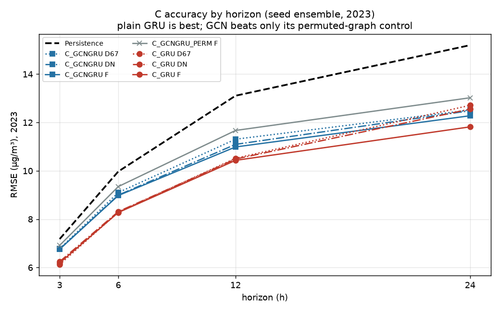
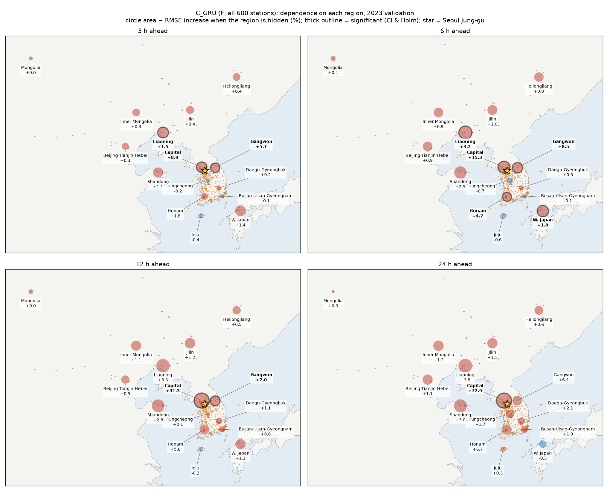
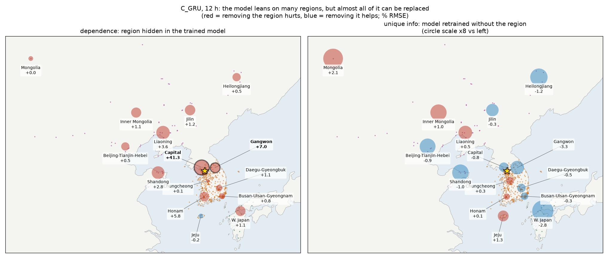
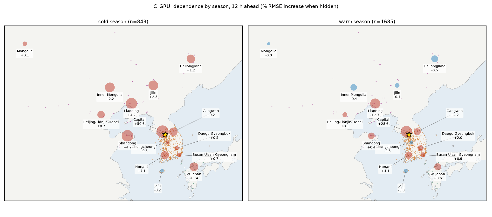
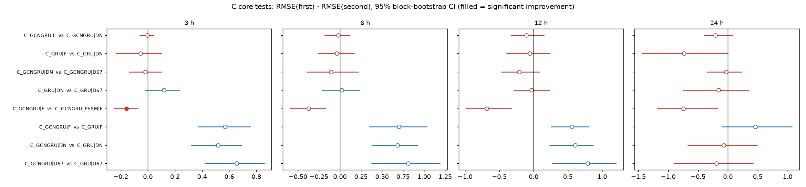
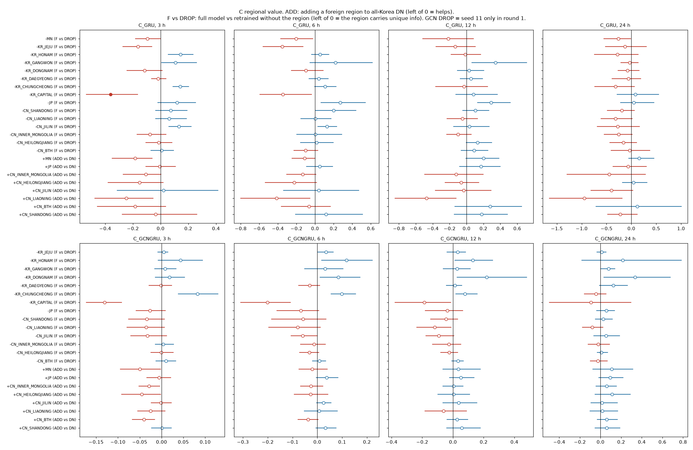
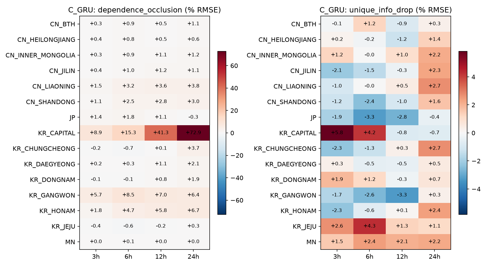

# 모델 C 결과 (2023 검증, 최종 시드 반영)

작성 2026-11-09. 팀 채점기 기준이며, 모든 수치는 같은 평가 행에서 낸 µg/m³ RMSE입니다.

**판정 규칙:** 블록 bootstrap 95% 구간 상한 < 0 **그리고** Holm p < 0.05.

> **시드 구성 (계획한 177회 중 168회 완료, 서버 종료로 9회 미완)**
> - 대부분은 시드 3개 앙상블입니다(모든 C_GRU, 핵심, 대조, 가리기, ADD, GCN DROP 11개 권역).
> - C_GCNGRU의 DROP_KR_GANGWON / HONAM / JEJU는 **시드 11만**입니다. 그 비교는 F도 시드 11끼리 맞춰 채점했습니다.
> - C_GCNGRU DROP_MN은 학습하지 못해 빠졌습니다.
> - 시드를 채운 뒤에도 결론은 1차와 같습니다. GCN 권역 비교 88개 중 유의한 것은 없습니다.

## 정확도 (시드 평균 앙상블)

| 모델 | 조건 | 3 h | 6 h | 12 h | 24 h |
|---|---|---|---|---|---|
| Persistence | — | 7.18 | 9.97 | 13.11 | 15.20 |
| **C_GRU** | D67 | **6.12** | 8.29 | 10.52 | 12.71 |
| C_GRU | DN | 6.24 | 8.31 | 10.49 | 12.56 |
| **C_GRU** | F | 6.19 | **8.28** | **10.43** | **11.82** |
| C_GCNGRU | D67 | 6.78 | 9.10 | 11.31 | 12.52 |
| C_GCNGRU | F | 6.76 | 8.98 | 10.99 | 12.28 |
| C_GCNGRU_PERM | F | 6.92 | 9.35 | 11.67 | 13.02 |

C_GRU(F)는 Persistence보다 오차가 지평별로 **14%, 17%, 20%, 22%** 작습니다.

## 가설 판정

| ID | 가설 | 결과 | 판정 |
|---|---|---|---|
| C-H1 | GCN-GRU가 GRU보다 낫다 | 반대입니다. **GRU가 3·6시간에서 유의하게 낫습니다**(차이 0.5–0.8, Holm p < 0.03). 12·24시간은 차이가 유의하지 않습니다 | **기각** |
| C-H2 | GCN의 이득은 실제 지리 덕이다 | 실제 그래프가 무작위 그래프보다 모든 지평에서 낫습니다(−0.16, −0.37, −0.68, −0.74). 규칙상 유의한 것은 3시간뿐입니다 | 방향은 지지, 유의성은 3시간만 |
| C-H3 | 전국 국내(DN)가 국내 67곳(D67)보다 낫다 | 두 모델 모두 차이가 없습니다 | 기각 |
| C-H4 | 국내 기준선 위에서도 중국 권역은 추가 가치가 있다 | ADD·DROP 180개 비교 중 유의한 것은 `F vs DROP_KR_CAPITAL`(GRU, 3시간) 하나입니다. 가장 큰 효과는 ADD_CN_LIAONING(GRU, 24시간 −0.95)이고, Holm 보정 후에는 유의하지 않습니다 | 기각(효과가 작고 불확실) |
| C-H5 | 궤적이 거의 지나지 않는 지역은 가치가 없다 | CTRL 3개 × 2모델 모두 유의한 개선이 없습니다 | 지지 |
| C-H6 | 중국 의존도는 겨울·서쪽 경로에서 크다 | GRU 가리기 결과, 랴오닝·산둥 의존도는 **추운 계절**에 큽니다(12시간: 랴오닝 4.2% vs 2.7%, 산둥 4.7% vs 0.4%). 하지만 경로별로는 서쪽(1.6–3.1%)보다 동쪽(5.5–7.3%)이 큽니다. 궤적 고도 바람이 지상 바람보다 조건을 더 잘 가르지도 않습니다 | 계절은 지지, 경로는 기각 |

## 권역 기여 (GRU, F 모델)

### 지도로 보기

**지역 가리기(의존도):** 원 넓이는 그 권역을 가렸을 때 RMSE가 몇 % 늘어나는지입니다. 굵은 테두리는 팀 규칙상 유의하다는 뜻이고, 별은 서울 중구입니다.

**의존도 vs 고유 정보 (12시간):** 왼쪽은 학습된 모델에서 권역을 가린 결과, 오른쪽은 그 권역을 빼고 다시 학습한 결과입니다. 왼쪽에서 크던 중국 권역의 효과가 오른쪽에서는 거의 사라집니다. 즉 다른 측정소 정보로 대체됩니다.

**계절별 의존도 (12시간):**

### 표·검정 그림

- **의존도(가리기):**
  - 유의한 곳은 수도권(3–24시간, RMSE +9% → +73%), 강원(3–12시간), 호남(6시간), **랴오닝(3·6시간)**, 일본(6시간)입니다.
  - GCN은 수도권에만 유의하게 기댑니다.
- **고유 정보(DROP 재학습):** 국외 권역은 모두 유의하지 않습니다.
  - 모델이 랴오닝에 기대기는 하지만, 빼고 다시 학습하면 다른 권역 정보로 대체됩니다.
  - 즉 랴오닝의 정보는 다른 측정소와 겹칩니다.
- **해석 주의:** 가리기와 DROP은 예측 정보의 의존도와 대체 가능성을 잴 뿐입니다. 배출 기여나 인과를 뜻하지 않습니다.

## 파일

| 경로 | 내용 |
|---|---|
| `scores/validation/<묶음>/` | 팀 채점기 출력 (`metrics`, `tests`, `conditions`, `seed_metric_summary`) |
| `scores/validation/summary_validation.md` | 묶음별 쌍 검정 표 전체 |
| `analysis/validation/region_contribution_by_horizon.csv` | 권역 × 지평 표 |
| `analysis/validation/region_contribution_by_condition.csv` | 권역 × 조건 표 |
| `runs/<모델>/<조건>/seed<k>/` | 예측(팀 형식)과 `meta.json` (`model.pt`는 서버에만 있음) |
| `logs/` | 실행별 학습 기록 |
